# Seatwise 设计文档

17 小组

> 设计正文。需求基线见 [SRS.md](SRS.md)，实测数字与图见 [evidence/](evidence/) 与 [fig/](fig/)，图源见 [uml/](uml/) 与 [svg/](svg/)。课堂汇报 ppt 与提交用的 PDF 在课程提交件中，不入库。

---

### 文档位置

配套材料都在 `docs/` 下：

| 位置 | 内容 |
|---|---|
| [SRS.md](SRS.md) | 需求基线 v3，含 R1 到 R12 变更日志与版本历史 |
| [evidence/reproduction-notes.md](evidence/reproduction-notes.md)、[evidence/evidence.json](evidence/evidence.json) | 第 0 章全部实测数字、复现口径与已知限制 |
| [fig/](fig/) | 实测图表 A-1 到 A-5 |
| [uml/](uml/)、[svg/](svg/) | 全部图的 PlantUML 源与渲染结果，按图号命名 |
| [mockups/](mockups/) | S1 到 S5 界面线框 |

文中图表的实测数字全部来自 0.1 节的两份公开数据，统计口径与筛选规则见 0.3 节。


---

## 0 数据与证据基础

作业要求设计具体到能指导实现，并写明假设、权衡与弱点。所以在正式章节之前，通过本节说明证据来源。

### 0.1 数据源

| 数据源 | 计划角色 | 实际可得性 | 结论 |
|---|---|---|---|
| 2016—2022 广外图书馆用户行为记录数据集（原计划数据源） | 训练、基线、回测 | 虽说相关论文里写了数据源被发布到图书馆杂志平台，但实际发现数据被作者标为受限，无法直接获得 | 考虑是否发邮件进行申请，无论如何目前阻塞，不能作为论证前提 |
| 2020 学年江苏大学图书馆用户行为记录数据集 | 更对口（含座位预约、签到、签退、使用时长） | 同样被作者标记为受限 | 同上 |
| **Wi-Fi Connection in HKUST Library** | 需求侧主数据 | DataSpace@HKUST，DOI `10.14711/dataset/RQXRQB`，CC0 1.0 协议 | 采用 |
| **KTH 图书馆区域占用（实时看板抓取）** | 占用侧验证集 | Hugging Face `davnas/real-time-library-occupancy` | 采用 |
两份受限数据导致目前存在缺口：缺少预约、签到、爽约这一层记录。公开的座位预约记录很少见，只能把这条缺口写成显式假设。之后考虑通过正规渠道申请这方面数据，或是使用 mock 数据。

以下是通过目前已有数据能够获得的结论：

### 0.2 两份数据的规格

| | HKUST | KTH |
|---|---|---|
| 粒度 | 日 * 楼层 * 用户群；日 * 时段 * 用户群| 约 190 秒 * 6 区域 |
| 覆盖 | 2014-02-01 -> 2022-05-31，98 个月，2981 / 3042 天（97.99%） | 2024-12-09 → 2025-07-31，231 天，95164 行 |
| 维度 | 楼层 G / 1 / LG1 / LG3 / LG4 / All-Floors；用户群 UG / TPG / RPG / Staff / Alumni / Others / Non-HKUST / Total | 6 个区域，容量代理 55–100 座 |
| 规模 | 143088 行（日×层×群）+ 158424 行（日×时段×群）+ 34560 行（小时级） | 95164 行 × 6 列计数 |
| 目前用途 | B3 需求模型、层级失衡、季节性、校历因素、漂移证据 | D1/D2 短时预测、基线对照、校准 |

### 0.3 质量评估

| 维度 | 实测 | 处置 |
|---|---|---|
| 完整性 | HKUST 日覆盖 97.99%（缺 61 天）；KTH 每日采样中位数 420，最差 77 | 缺失日打标记，不插值 |
| 一致性 | 用户群求和 = Total：99.99%（17886 组） | 采用 |
| 跨层口径 | 楼层求和 = All-Floors 只有 3.15% 的日期成立，偏差中位数 1,291 | 总量取 All-Floors（跨层去重），层级取分层值，两者不相加 |
| 有效性 | HKUST 零人次 62 天（2.08%）；KTH 有封顶伪影，2025-07 整月闭馆 | 闭馆期剔除，封顶行截尾 |
| 语义 | HKUST 的 User-Count 是当日去重到馆人数，不是并发（小时级求和是日级值的 3.85 倍） | 只做需求口径，不用于计算占用率 |
| 覆盖度 | 无课表、天气、活动等外部因素；`WiFi-Conn / User-Count = 7.79` | 输出带 coverage 与代理口径声明 |

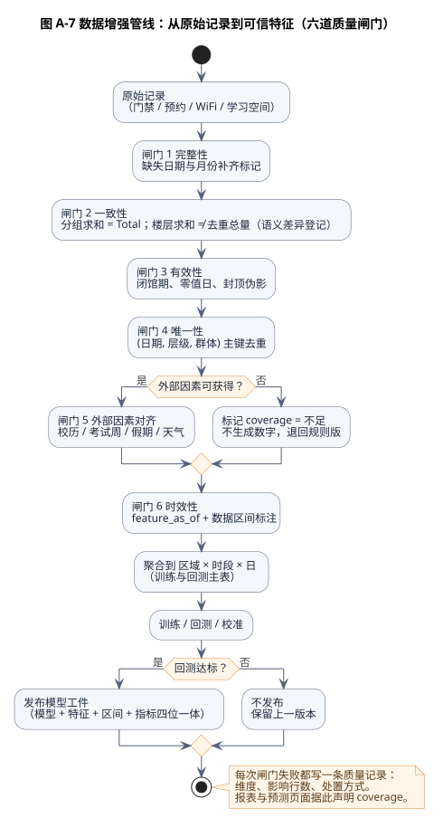

图 A-7 数据增强管线。六道闸门任一失败都记一条质量记录（维度、影响行数、处置），报表与预测页面据此声明 coverage。

### 0.4 实测结论

① 到馆需求在楼层间高度不均。工作日日均 LG1 2077、LG4 1494、G 1428、LG3 1025、1F 517；份额中位数 32.6% / 21.7% / 21.7% / 14.3% / 7.7%，四分位间距 2.9 到 7.2 个百分点，一年之内几乎不动。日值是当日去重人数而非并发（全馆单日最高 9632 人次，座位约 3589 个），所以只能说需求分布不均，推不出占用率。

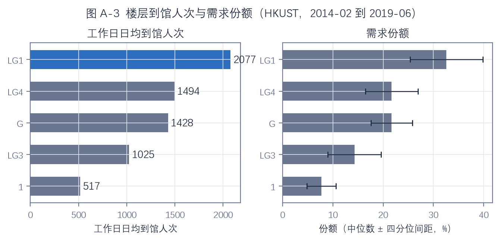

② 日内需求集中在两个时段。午后 34.5%、傍晚前 30.9%，合计 65.4%；上午 18.3%，晚间 12.7%。

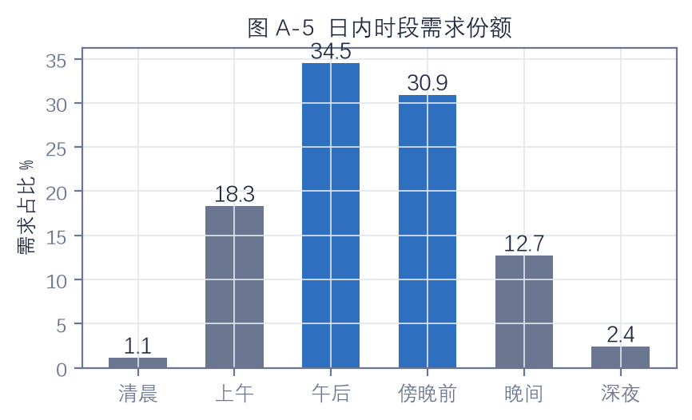

③ 校历把解释力从 0.18 提到 0.45。以 log 日人次回归：只用星期 R²=0.073，加周末与假期 0.177，加学期与考试期 0.434，再加学期第几周 0.452；分期间中位数是学期内 4876、考试期 3729、假期 1294。

考试期低于学期内的现象很反直觉，具体来说：它在 11 个学期里逐个成立，工作日更明显（5391 对 4030），不是周末结构造成的。我们的解释是课程结束后通勤型到馆消失、只剩考生；同期晚间份额从 13.5% 升到 15.8%、深夜从 2.7% 升到 4.6%，来的人少了但待得更久。

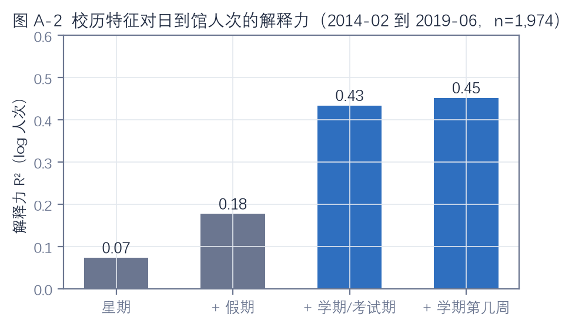

④ 30 分钟前瞻上 persistence 很难被击败。KTH：0.0299，季节朴素 0.0821，季节形状乘近期水平 0.0352。日粒度相反：HKUST 留出集（2018-09 到 2019-06，n=303，均值 3077）persistence 835、同日上周 852、周均值 1375、周中位数 1334，季节形状乘近期水平 651，好 22.0%。

这条改了 D2 的验收口径（见 R8）。30 分钟尺度上承诺相对 persistence 提升 25% 既不现实，也说明不了什么；D2 要给的是可校准的概率与分档。校准实测（事件为利用率 ≥ 0.50，基准率 10.2%）显示朴素季节模型在高分段过度自信：预测 0.777 时实际 0.647。

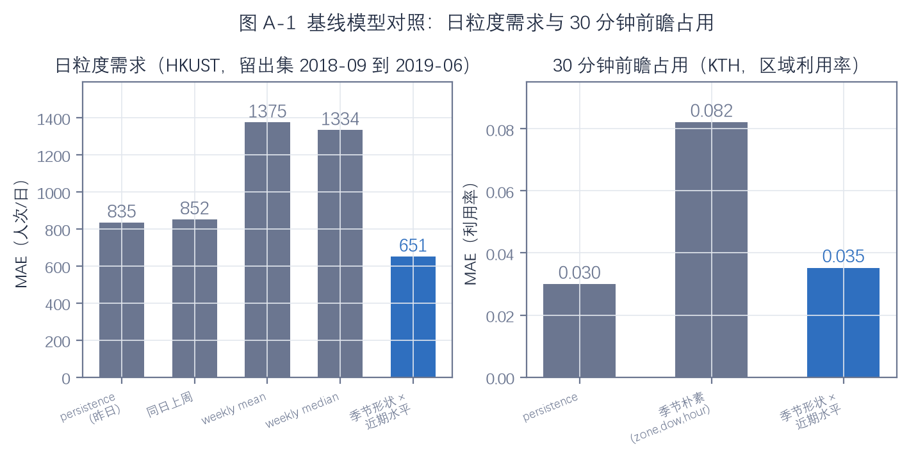

⑤ 存在制度性断点。年日均人次 2014 年 3462，2020 年 630，2021 年回到 3027；同期 LG1 份额从 34.4% 降到 20.7%，LG3 从 12.9% 升到 29.3%。只训练一次、只在固定窗口回测的模型遇到 2020 年会出错，这是因为 2020 年以及以后几年的情况特殊，第 7 章的漂移检测由此而来。

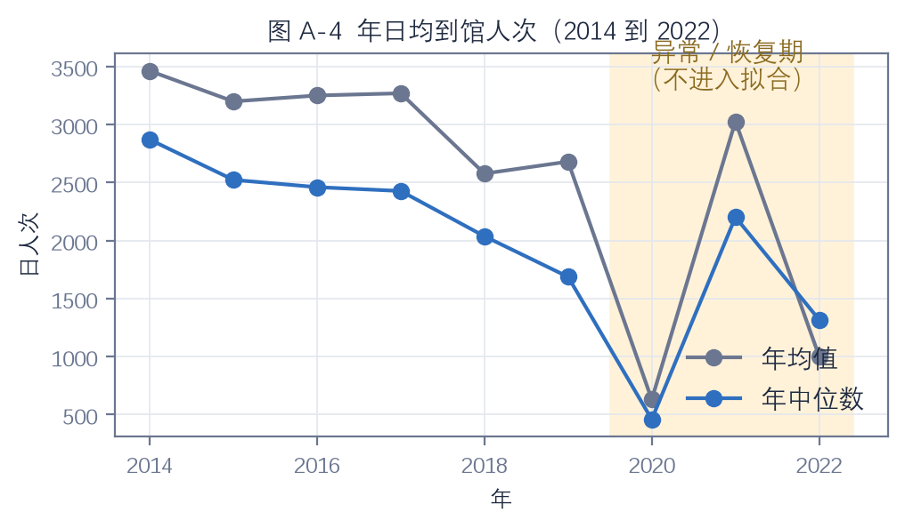

---

## 1 Design Summary

Seatwise 作为校园座位预约及供需治理平台，目标是把校园座位从简单的选座订座过程推进可预测、可治理的智能水平。由于选座、签到、超时释放已经商品化，之前 Part I 的提案被批评场景陈旧；因此，我们决定要在这个陈旧的场景中更深入一些，去回答那些之前的产品回答不了的事，比如，对学生来说：某个时段去某个区域还找不找得到座、如何规划自己的学习时间与学习地点能利用好学校的资源；对管理方来说：规定这样改一改能不能有效提高设施利用率、一条新规上线后总体情况究竟变好还是变坏。

论证依据：HKUST 图书馆 8 年 WiFi 使用统计做需求侧，KTH 图书馆 6 区域的 3 分钟级占用做占用侧。细节在前文有过叙述，此处不再赘述。

架构是模块化单体，重心在约束。预约状态机配合唯一索引等，确保不发生超卖；政策参数版本化，让历史版本可以回滚；预测模块对业务表只读，只写三张结果表，由数据库账号实现这个效果；外部依赖经四个端口与一个事件出口接入，三元开关让任一能力单独降级。机制类杠杆（候补补位、信用优先权、峰值轮换、楼层权重）写成政策参数，与预测解耦，预测不可用时，主链路照常工作。

已知弱点：目前没有预约与签到记录的数据，爽约率与停留时长只能用假设区间；两份数据都不是本校数据，可能不够贴合具体情况。

---

## 2 架构与关键决策

### 2.1 逻辑架构

系统边界内有四个运行时容器：前端 `web`、后端 `api`、离线 `worker`、机器学习 `ml`（离线，不进运行时）。`api` 内部按业务能力切成五个模块，模块之间只经应用服务接口调用，不跨模块读表。

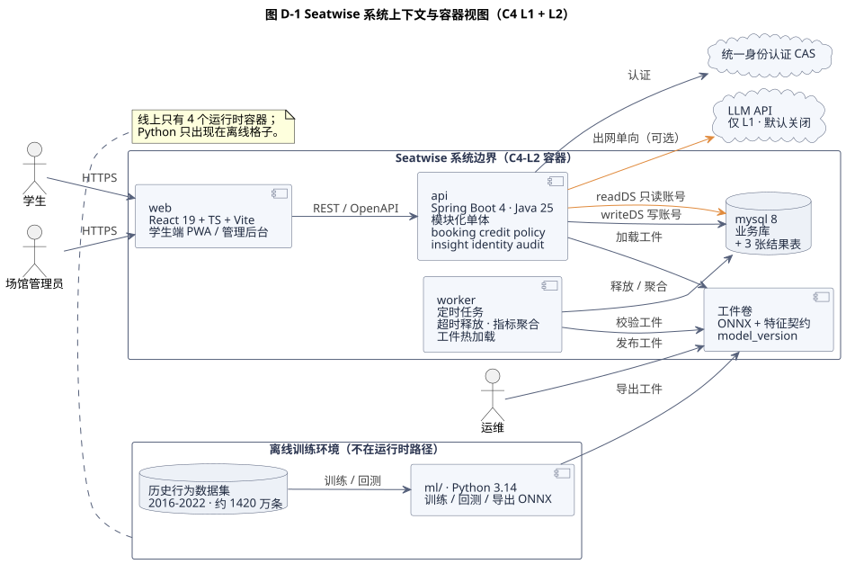

| 模块 | 职责 | 对外接口 | 写权限 |
|---|---|---|---|
| `booking` | 预约状态机、签到、释放、候补队列 | REST（学生 / 管理员） | 业务库 `booking` / `booking_event` |
| `credit` | 计分规则、信用账本、申诉 | REST | `credit_ledger`（只追加） |
| `policy` | 政策参数、版本、生效指针、模拟入口 | REST | `policy_version` |
| `insight` | 看板、报表、指标口径 | REST | 读物化汇总表 |
| `prediction` | 打分、概率分档、结果落库 | 内部服务 + 结果表 | 只写 3 张结果表 |
| `identity` / `audit` | 认证、RBAC、审计 | 中间件 | `audit` |

两条数据通道是架构的硬约束：写通道用业务账号，决策通道用只读账号读业务视图、只写三张结果表。预测改不了业务数据，这件事由数据库权限保证。

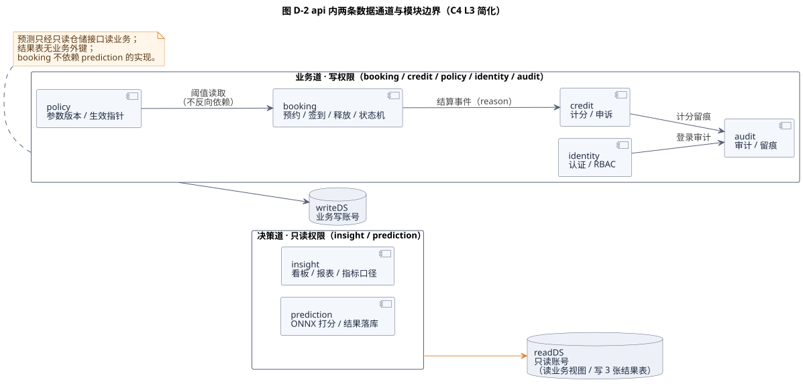

### 2.2 部署架构

演示环境将是单机 Compose，三个容器加一个 MySQL；生产候选（理想情况，我们无法实测）是 VM 版，同样三个进程。迁移只需三步：配置外部化、`api` 保持无状态（会话、缓存、工件全外置）、工件卷换成对象存储并按 `model_version` 建目录，回滚就是指回旧目录。当前规模不需要 K8s，容器化保留了迁移接口。

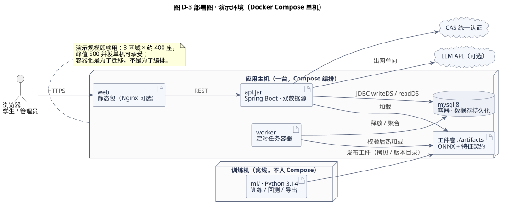

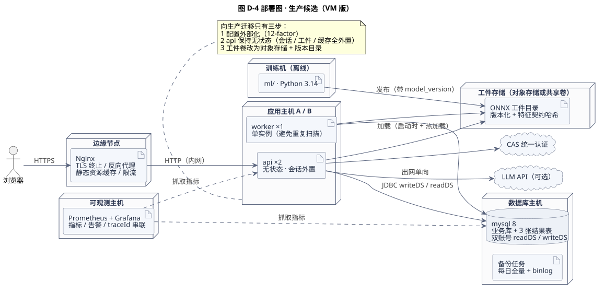

### 2.3 技术架构与备选

| 层 | 选择 | 备选与否决理由 |
|---|---|---|
| 前端 | React 19 + TS + Vite | Vue：前端同学有 React 开发的相关经验，且对这个场景来说两个框架差异不大 |
| 后端 | Spring Boot 4 / Java 25 | Python FastAPI：性能稍差，更灵活也更容易出问题，而且并发一致性要自己写事务与锁 |
| 机器学习 | PyTorch / uv / Python 3.14 | 直接在 Java 里训练：生态不足 |
| 在线打分 | ONNX Runtime for Java | 独立 Python 推理服务：多一个网络跳点与偏斜来源；纯结果表预计算：无法支持任意区域×时段组 |
| 存储 | MySQL 8 · 双账号 | Postgres：团队已有 MySQL 运维经验 |
| 部署 | Compose 单机 | K8s：当前规模不需要，抽象成本大于收益 |
| 外部模型 | 仅 L1（自然语言→检索参数），默认关闭 | 全链路 LLM：被老师否决，非必要的成本 |

### 2.4 质量属性场景

| 刺激 | 响应 | 度量 | 对应需求（具体可见附件的 SRS ） |
|---|---|---|---|
| 100 并发抢同区域最后 1 座 | 唯一索引 + 行锁 + 状态断言 | 重复分配 0 例 | 7.3.2 |
| 同一批释放事件重放 3 次 | 幂等键 `(业务键, op, version)` + 条件更新 | 账本条目数不变 | 7.3.1 |
| 预测服务整体不可用 | 页面隐藏数值，回规则版 | 主流程可完成 | 7.3.4 |
| 校历 / 外部因素端口连续 7 天无数据 | coverage 标记为不足，不生成数字 | 无裸概率上线 | 7.1.4 |
| 模型 MAE 连续 5 天超阈值 | 告警 + 自动回滚上一版本 | 回滚 ≤ 10 分钟 | 7.3.5 |
| 需求结构发生位移（如 2020） | 漂移检测触发重训，未达标不发布 | 方向一致率 ≥ 80% | 7.6.1 |

### 2.5 架构风险

| 风险 | 影响 | 缓解 |
|---|---|---|
| 代理指标偏差：WiFi 人数 ≠ 座位占用 | 需求侧模型系统性偏移 | 口径声明 + 以自建日志做偏移校正；不把 WiFi 数当座位数用 |
| θ 未标定 | 改善目标可能高估 | 三档情景只给区间；θ 作为 Part III 第一优先 PoC，测不出就不放开超额准入 |
| 双数据源权限被误用 | 预测写入业务表 | 数据库权限 + 一条“用预测账号写业务表应全部被拒”的验收用例（7.7） |
| 单体耦合 | 后期拆分成本 | 模块边界不外溢 + 端口隔离；不预留未使用的抽象 |
| 政策版本与模型版本交叉 | 归因失效 | 三元开关同时记录，模拟报告带 `policy_version` 与 `model_version` |

---

## 3 关键决策记录（ADR）

| # | 决策 | 备选与否决理由 | 代价 |
|---|---|---|---|---|
| ADR-1 | Spring Boot 模块化单体，五个模块同进程、分 schema | 微服务：五个服务的部署与一致性成本过大；全栈 FastAPI：性能较差，且事务、锁与幂等要自己实现 | 单进程部署耦合，任一模块崩溃影响全体；缓解是模块间只经接口调用，为拆分留缝 |
| ADR-2 | `ml` 导出 ONNX 工件与特征契约，`api` 用 ONNX Runtime 打分 | 独立 Python 推理服务：多了一跳网络与二次特征实现；纯结果表预计算：覆盖不了任意区域乘时段的组合，页面还会显示过期值 | 双端打分要保证一致（误差 < 1e-3，Part III 验收项），Java 侧不便试验新模型结构 |
| ADR-3 | 并发控制落在数据库：唯一索引 + 行锁 + 状态断言 | Redis 分布式锁：引入外部依赖，崩溃场景下锁语义更难论证 | 热点行可能需要等待 |
| ADR-4 | 业务写账号与预测只读账号分离，预测只写三张结果表 | 单账号靠代码规范：规范会被绕过；独立 schema：同实例下权限粒度不够 | 两套连接池与两个事务边界 |
| ADR-5 | 政策参数版本化，生效指针唯一 | 参数快照入单表：历史不可回滚；就地改参数：没法查询历史规则 | 每次读取多走一次主键查询 |
| ADR-6 | 证据分三层：需求侧 HKUST、占用侧 KTH、爽约侧待自建日志 | 只用 KTH 一份：只有一个学期，区域级利用率仅 27.7%，撑不起季节性与校历结论；申请/寻找其他数据源：需要时间，在做，但是目前不能因为这个阻塞整体进程 | 两份数据都不是本校数据，外推需一次自有日志复核 |
| ADR-7 | 校历、考试周、课表经 `AcademicCalendarPort` 进入特征管线 | 把校历编码写死在 `ml` 脚本里：每年手工改一次，失败也无法解释 | 多一层适配与一个版本契约 |
| ADR-8 | 候补、信用优先、峰值轮换、楼层权重作为政策参数独立存在 | 全部由预测驱动：政策绑在模型可用性上，主链路会因为预测出问题而停摆 | 参数空间变大 |

---

## 4 设计模型

### 4.1 领域模型

十一个核心类支撑三条不变式：

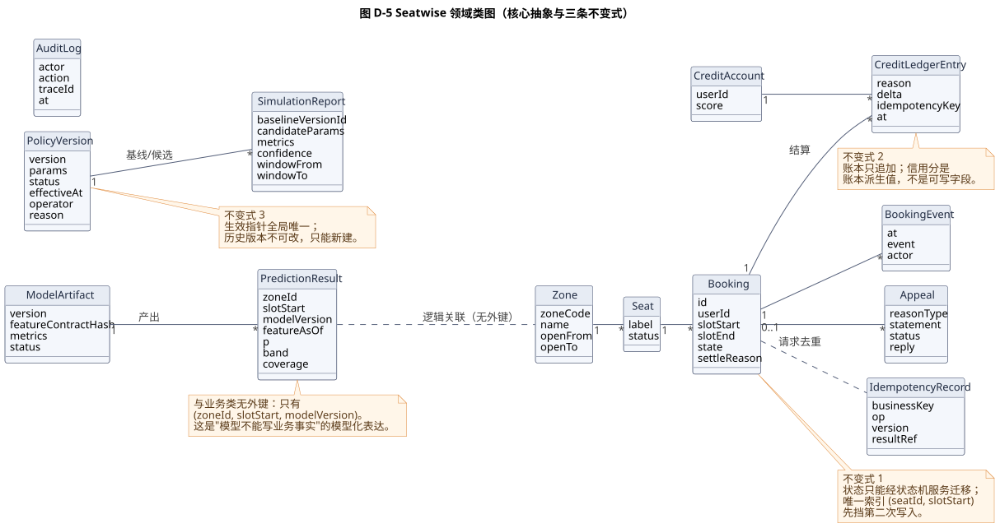

1. 状态只能经状态机迁移。`Booking.state` 不对任何模块直接开放写入口，唯一索引 `(seatId, slotStart)` 在数据库层先挡住第二次写入。
2. 账本只追加。`CreditLedgerEntry` 只 append，`CreditAccount.score` 是由账本派生的视图值，不是可写字段。
3. 政策版本不可就地修改。`PolicyVersion` 生效指针全局唯一，历史版本只能新建、不能改。

`PredictionResult` 与业务类之间没有外键，只有 `(zoneId, slotStart, modelVersion, featureAsOf, p, band, coverage)` 这组字段。模型写不了业务事实，这层关系就是它的模型表达：即便预测结果被错误关联，也关联不到任何一条预约。


### 4.2 用例实现

UC-02 预约（并发不超卖）。幂等键先查，命中即重放，不重复写。未命中则开事务，插入靠唯一索引拦重复，`SELECT ... FOR UPDATE` 锁单座，状态断言校验信用与配额；冲突时返回 3 个备选，客户端不用重试。预测值全程只参与备选排序，不参与校验。

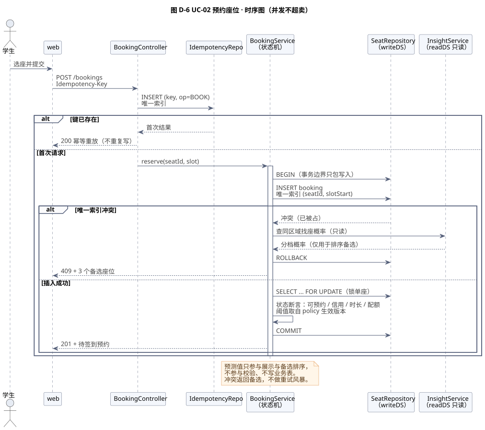

UC-06 超时释放（至多一次）。批量取 ≤ 200 条过期预约，逐条条件更新（`WHERE state = 'PENDING_CHECKIN'`），成功才写账本；幂等键是 `(预约号, reason=NO_SHOW, policy_version)`。已签到的跳过，中断可续跑，重放不重复扣分。

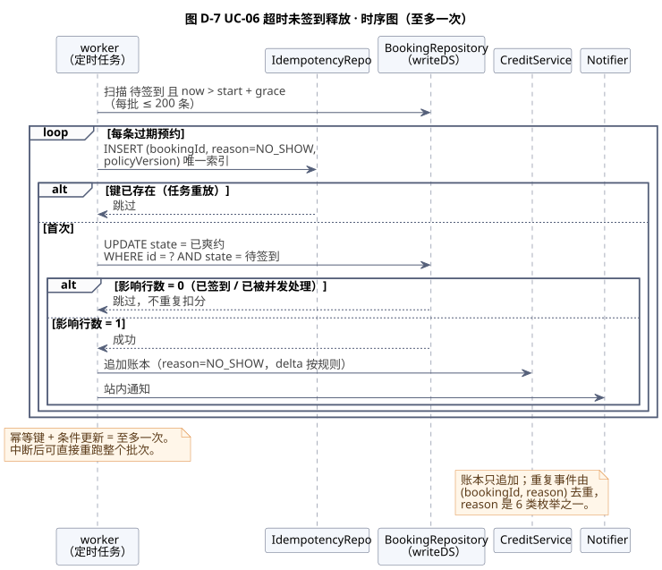

UC-14 政策模拟（反事实，无副作用）。重放历史事件流，基线列与候选列并行计算；结果只追加到 `simulation_report`，页面按钮写的是“保存为新版本”，不是“应用”，生效只能走 UC-12。

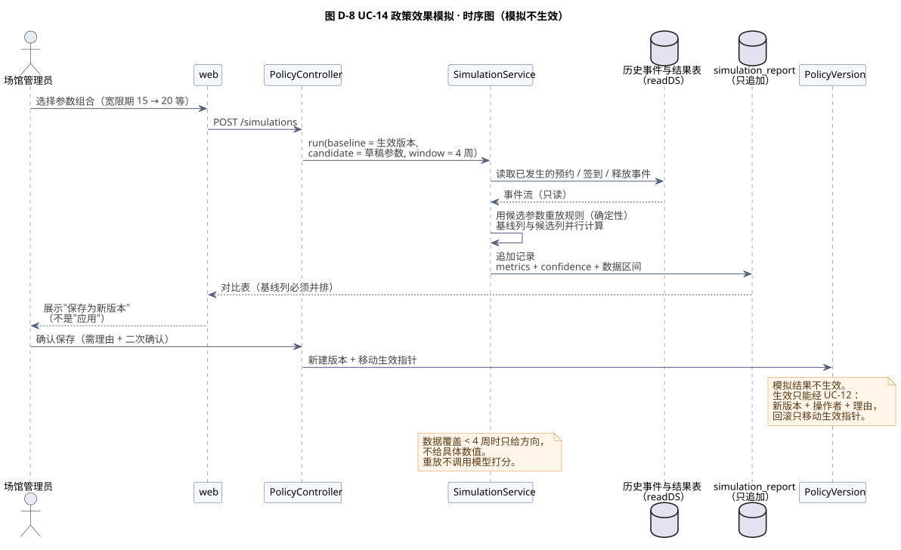

状态机。六种状态、六类结算原因。状态回答现在是什么，`reason` 回答为什么结束，账本与幂等键都以 reason 为键。

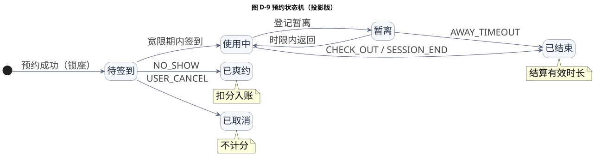

### 4.3 新增用例的模型影响（UC-18 候补队列）

候补不是预约的一个状态。把“候补中”塞进 `Booking.state`，状态机会多出 3 条迁移，而候补与预约的并发语义完全不同（候补不锁座，只在释放事件上排队）。因此新增独立实体：

| 类 | 关键字段 | 不变式 |
|---|---|---|
| `WaitingListEntry` | `zoneId`、`slotStart`、`userId`、`priority`、`enqueuedAt`、`status` | 同用户同区域同时段唯一；`priority` 由信用分与入队时间共同决定，不接受手工插队 |

释放事件发生时，`booking` 发布 `SeatReleased`，候补服务按 `(priority desc, enqueuedAt asc)` 取首个可用条目，生成一条待确认预约并通知，超时未确认顺延下一位。候补因此不需要消息中间件，`booking` 也不必依赖候补模块。

---

## 5 需求变更（R7 到 R12）

SRS v3 已记录 R1 到 R6（Part I 到设计首轮）。本章记录本轮课堂反馈与实测数据导致的六条修订目。下表中的条款号均指 [SRS.md](SRS.md) 的编号。

| ID | 原条款 | 新条款 | 起因 | 影响面 |
|---|---|---|---|---|
| **R7** | SRS 附录 A：以广外数据集（1,420 万条）为有效数据，训练、基线、回测、模拟均基于此 | 有效数据改为两份：HKUST 图书馆 WiFi 使用统计（需求侧主数据，CC0）与 KTH 图书馆区域占用（占用侧验证集）；广外与江苏大学两份降级为“持续申请中”，不再作为论证前提 | 两份《图书馆杂志》数据集在平台被标记为受限，登录亦不可下载（实测：详情页、三种 API 均 412/受限）；而设计不能在“等数据”上停摆 | 附录 A 全节、3.5 业务目标的数据来源、7.6.1 验证方法、M3 里程碑退出准则 |
| **R8** | 7.6.1：占用预测（30 分钟前瞻）MAE ≤ 8pp，**相对持续性基线提升 ≥ 25%**，覆盖率 ≥ 90% | 拆成两条：**日粒度需求预测**相对 persistence 提升 ≥ 20%（实测 22.0%）；**30 分钟前瞻占用**要求“不劣于 persistence 10%”叠加**概率校准**（分档偏差 ≤ 5pp、Brier 优于常数预测）。MAE ≤ 8pp 作为报告指标保留，不再作为通过条件 | 实测 persistence 在 30 分钟尺度上 MAE 仅 0.030，原目标要么不可达要么无意义；而 D2 的真实价值是给出可校准的概率分档，实测朴素季节模型在高分段过度自信 13 个百分点 | 7.6.1 全部指标、7.7 验证方式、M3 退出准则、4.2 的 D2 描述 |
| **R9** | 5.3 无候补用例；UC-12 政策参数只含宽限期、时长上限、信用阈值、超额比例 | 新增 **UC-18 候补队列与自动补位**；UC-12 参数扩为 8 项，增加候补规则、信用优先权、峰值时长轮换、楼层权重 | 反馈 1：除历史数据与经验规则外还有其它优化资源利用的方式。候补与优先权不需要新数据，收益却可能大于预测 | 5.3、5.4、UC-12、4.3、政策参数表、8.4/8.5 界面 |
| **R10** | 7 章无数据质量条款；外部因素（校历、考试周、课表）未出现 | 新增 **7.4.6 数据质量六维与闸门**（完整性 / 一致性 / 有效性 / 唯一性 / 时效性 / 覆盖度，每维给阈值与处置）、**7.6.5 外部因素接入**（校历、考试周、假期经 `AcademicCalendarPort`，失败降级并标记 coverage） | 反馈 3：现有数据质量与历史数据增强需要考虑。实测校历把解释力从 0.177 提到 0.434，且发现“楼层求和 ≠ 去重总量”这一语义陷阱 | 7.4、7.6、附录 A、数据管线（图 A-7） |
| **R11** | 7.3 无漂移条款；7.5.3 只要求模型可追溯 | 新增 **7.3.6 漂移与再训练触发**（滚动 MAE 连续 5 天超阈、份额结构位移超阈值、校历端口失联 7 天，任一条触发告警并按需回滚）、**7.5.6 结构变更留痕**（楼层份额、用户群构成变化入库备查） | 反馈 2：如何提高系统的适应能力。实测 2020 年需求降至常态 1/5，楼层份额最大位移 16 个百分点 | 7.3、7.5、M5 演练、图 A-4 |
| **R12** | 7.1.4 概率必带四项口径；7.6.4 未提代理指标 | 7.1.4 增加 `coverage` 与**代理指标声明**：任何由 WiFi / 门禁推断的人数必须标注“代理口径”，不得与座位占用混称；无外部因素时覆盖率标记为不足 | 实测 `WiFi-Conn / User-Count = 7.79`（设备去重估算），直接当座位数会系统性高估 | 7.1.4、7.6.4、8.1 概率组件、UC-01/09 |

未变的部分：产品定位与取舍（2.1、4.1）、统计模型与 LLM 的能力清单与两条边界（3.6）、里程碑划分（4.2 的时间节点不变，退出准则按 R8/R10 调整）、参与者与用例划分、非目标清单。

---

## 6 优化目标与约束

之前课堂上的报告，收到了老师反馈，第一部分：“系统尝试提高‘稀缺’资源的‘利用率’，相对于旧风格能改善到什么程度，预测和治理的效果可以达到怎样的效果，可以说明一下，并作为利用有限资源实现较好预期的约束。”

这一章先把两件事分开，否则“提高利用率”这个说法会出错：

- 引导是预测的直接产物，它不改变总利用率。一个座位被谁坐，不影响它被坐的时长。引导改的是找座失败率与搜寻成本。
- 抬高利用率的是回收浪费与加快周转：缩短宽限期、临期提醒、释放即补位（候补）、峰值时长轮换、开放时段与楼层再配置。预测在这里的作用是让政策选择有依据、让补偿精准，它本身不产出利用率。

分开之后，“能改善到什么程度”才有可推导的答案。

### 6.1 三条约束（实测）

约束 1，供给侧容量固定。演示场馆 3 区域、约 400 座、08:00 到 22:00，日可开放 400 × 840 = 336,000 座·分钟。短期内座位数与开放时段不可变，分母是常数。

约束 2，需求侧结构不均。楼层失衡 4.0 倍（2,077 对 517 人次/日）；日内 65.4% 的需求落在两个时段；周末需求约为工作日的 47%。结构越不均，引导的空间越大；份额本身稳定（IQR 仅 2.9 到 7.2 个百分点），所以既预测得了，也能被政策改动。

约束 3，可迁移比例 θ。只有愿意换区或换时段的到达才能被引导。θ 是唯一未标定参数，假设区间 0.15 到 0.35，Part III 用自建系统日志标定。θ 测不出来，第 6.4 节的闸门就不放行超额准入。

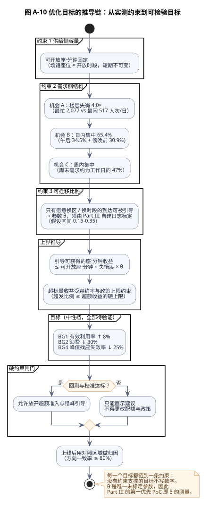

### 6.2 上界推导

设：
- `C` = 日可开放座·分钟 = 336,000
- `w` = 浪费率 = 浪费座·分钟 ÷ `C`（爽约 + 占座未用 + 早退空置），假设 12%，区间 8% 到 18%
- `r` = 可回收比例（宽限期、提醒、候补补位、轮换能从 `w` 中拿回的比例），假设 0.35，区间 0.20 到 0.50
- `θ` = 可迁移比例，假设 0.25，区间 0.15 到 0.35

利用率的上界，只由回收驱动，与预测无关：

```
U_old = 1 − w
U_new = 1 − w + w·r = 1 − w(1 − r)
相对提升 = w·r ÷ (1 − w)
```

代入假设：`w·r = 0.042`，`1 − w = 0.88`，相对提升 4.8%；区间 1.8%（保守）到 11.0%（乐观）。

找座失败率的上界，由引导驱动：

```
失败率下降相对值 ≤ θ × (峰值时段失衡可纠正比例)
```

KTH 区域级实测给了这条上界的第一个锚点：按预测改选区域，工作日 8 点到 20 点的 36,886 次到达中，找不到座的比例从 1.29% 降到 0.99%，相对降 23%。区域级稀缺本来就低（各区域已满时间占比 0.1% 到 3.3%），绝对收益小；座位级稀缺远高于此，相对收益应当更大，但必须由自建日志测量，不能外推。

### 6.3 三档对照

三种风格：A 旧风格（无预测、无准入、固定 15 分钟宽限期、无候补、无轮换）；B 仅预测（A 加 D2/D3 展示，规则不变）；C 预测加治理（B 加有上限超额准入、错峰引导、候补补位、峰值轮换、信用优先）。

| 指标 | 度量口径 | A→B 的贡献 | B→C（中性档） | 区间（保守 / 乐观） | 依据 |
|---|---|---|---|---|---|
| 有效利用率 | 有效座·分钟 ÷ 336,000 | +0.3～0.8pp | **+4.8%** | +1.8% / +11.0% | `w·r ÷ (1−w)` |
| 浪费座·分钟率 | 浪费 ÷ 336,000 | −2%～−5% | **−30%** | −20% / −50% | `r` 主导，`w` 由 Part III 标定 |
| 峰值找座失败率 | 失败到达 ÷ 总到达 | −8% | **−25%** | −15% / −35% | θ 与 KTH 实测 −23% 锚定 |
| 找座决策时间 | 首次点击 → 确认 | −30% | **−40%** | −25% / −50% | 界面级估计，无外部证据 |
| 政策评估周期 | 需求提出 → 报告 | — | **≤ 1 天** | — | 流程改造，可当场演示 |

两条判断：

1. A→B 的贡献很小是正常的。只显示概率而不改规则，能改变的只有用户选择，改变不了浪费与周转。把预测单独吹成“提升利用率 20%”是不可信的。
2. B→C 的收益主要来自机制，模型精度贡献很小。 这与反馈 1 的判断一致（详见第 7 章），也是本设计把机制类杠杆与预测解耦（ADR-8）的原因。

### 6.4 硬约束闸门

每个目标都配一道闸门，达不到就不放行对应能力。

| 闸门 | 通过条件 | 不通过时的行为 | 影响的能力 |
|---|---|---|---|
| G1 需求侧预测 | 日粒度 MAE 相对 persistence 提升 ≥ 20% | 不生成日粒度建议值 | 错峰引导的时段推荐 |
| G2 占用侧预测 | 30 分钟前瞻不劣于 persistence 10%，且分档校准偏差 ≤ 5pp | 概率只显示分档、不显示数值 | D2 概率、UC-09 建议 |
| G3 覆盖率 | `coverage` ≥ 90%（有外部因素、数据未过期的区域×时段占比） | 显示“暂无可靠预测” | 所有概率展示 |
| G4 θ 标定 | 自有日志测得的 θ 落在置信区间内且 > 0.10 | 禁止放开超额准入 | C1 配额建议 |
| G5 政策模拟 | 至少一次“模拟 vs 上线后实测”方向一致 | 模拟结果只作参考，不进入决策记录 | UC-14 的可信度标注 |

G1 与 G2 的阈值已按实测调整（R8）。原目标“30 分钟前瞻相对提升 25%”在 persistence 已达 0.030 的数据上不可达，硬写会让整个验收体系失效。

---

## 7 治理杠杆与适应性

### 7.1 六条系统内杠杆

老师反馈的第二部分：“除了利用历史数据和一些经验规则，还有其它方式优化资源利用，可以尝试更多分析下。”

这里问的是除历史数据与经验规则之外还有没有别的优化方式。答案是不靠数据的那一类：机制设计。六条杠杆都落成政策参数（UC-12），各有独立开关。

| # | 杠杆 | 作用指标 | 政策参数 | 是否需要新数据 | 依据与备注 |
|---|---|---|---|---|---|
| L1 | 时段错峰引导 | 峰值找座失败率 | 引导触发阈值、候选数（≤3） | 需要 D2 | 已有 UC-09；区域级实测 −23% |
| L2 | 楼层 / 区域再配置与开放时段调整 | 空间利用率、失衡度 | 楼层权重、开放时段、区域状态 | **不需要** | 楼层失衡 4.0×，收益来自供给侧而非需求侧；管理员决策，系统只出建议 |
| L3 | 有上限超额准入 | 有效利用率 | 超额比例上限、回退条件 | 需要 D3 | 收益管理经典做法；G4 未通过则禁用 |
| L4 | 候补队列与自动补位 | 浪费座·分钟率、周转 | 候补容量、确认超时、顺延规则 | **不需要** | 新增 UC-18；释放即补位，是回收浪费最直接的手段 |
| L5 | 信用分换优先权 | 公平性、违约率 | 优先权档位、信用门槛 | **不需要** | 复用已有治理；高信用用户可提前订或订更久，把稀缺资源分给低违约人群 |
| L6 | 峰值时段时长上限与强制轮换 | 周转率 | 峰值单次时长上限、轮换间隔 | **不需要** | 高需求时段缩短单次上限，提高座位每小时可服务人数 |

从这些机制出发，能够多管齐下地优化资源利用。

### 7.2 两条系统外建议（只写不做）

| # | 建议 | 为什么不做进系统 |
|---|---|---|
| L7 | 与教务排课协同，把课程需求移出峰值时段 | 涉及跨部门协商，系统只能产出“峰值时段需求构成”报表作为谈判依据 |
| L8 | 物理空间改造（静音区 / 研讨间比例） | 资本开支决策，超出课程项目范围；同样只出数据 |

### 7.3 为什么不做价格机制

校园场景下竞价与动态定价和公平性冲突，还会带进支付、退费、审计三套流程（SRS 4.1 已把支付列为非目标）。L5 的信用优先权用来替代价格：分配信号是信誉，不是钱，信用分来源可解释、可申诉。

### 7.4 扩展点

反馈的第三部分：如何提高系统的适应能力，可以尝试预留一些接口；

第三部分问的是如何提高系统适应能力、能否预留接口。我们决定预留 4 个端口、1 个事件出口、1 组三元开关，都只换实现、不改契约。

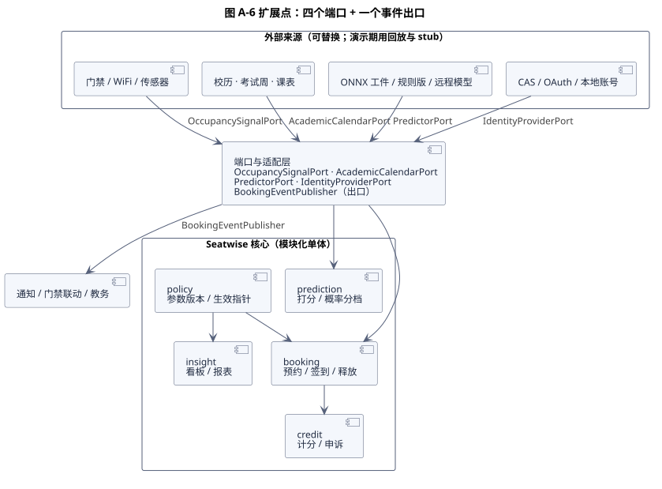

| 端口 | 契约 | 演示期实现 | 替换场景 | Part III 是否实现 |
|---|---|---|---|---|
| `OccupancySignalPort` | `read(zoneId, from, to) → 序列 + 质量标记` | CSV 回放（KTH / HKUST） | 接门禁、WiFi 控制器、传感器 | 实现 stub + 回放 |
| `AcademicCalendarPort` | `phaseOf(date) → in_term / exam / break`；`holidays(year)` | 本地校历文件（已解析） | 接教务系统或校历服务 | 实现 stub |
| `PredictorPort` | `score(featureVector) → {p, band, coverage, modelVersion}` | ONNX 工件 | 换模型族、换远程服务 | 实现两实现（规则版 / ONNX） |
| `IdentityProviderPort` | `authenticate(credential) → 用户 + 角色` | 本地账号 | CAS / OAuth | 只留接口 |
| `BookingEventPublisher` | `publish(event)`，事件含 `bookingId / seatId / reason / policyVersion` | 结构化日志消费者 | 通知、门禁联动、教务 | 实现日志消费者 |

三元开关是 `policy_version`、`model_version`、`feature_flag`。任一能力可单独关闭，关闭后的行为如下：

| 关闭项 | 降级行为 | 主流程受影响？ |
|---|---|---|
| 预测（全部） | 隐藏数值，回规则版与实时座位图 | 否 |
| 外部因素端口 | `coverage` 标记不足，不生成数字 | 否 |
| 候补队列 | 释放后直接回到可约池 | 否 |
| 超额准入 | 配额回归 1.0 | 否 |

### 7.5 适应性

第三部分的另一半是系统怎么适应变化。证据就是那张 2020 年的曲线：年需求降到常态的 1/5，楼层份额最大位移 16 个百分点，只训练一次的模型在那一年会全错。适应因此做成机制（R11）：

| 触发条件 | 检测方式 | 响应 |
|---|---|---|
| 滚动 MAE 连续 5 天超阈值 | 与上一版本同期比较 | 告警；按需回滚（≤10 分钟） |
| 需求结构位移 | 楼层份额、用户群构成的滚动对比超阈值 | 告警 + 建议重训 |
| 外部因素端口失联 ≥ 7 天 | 端口健康检查 | 降级 + 标记 coverage |
| 回测与线上偏差持续 > 20% | 每周对账 | 重训，未达标不发布（图 A-7 的最后一道判断） |

这套机制不依赖预测能力，模型全线不可用时照常工作，这是 ADR-8 换来的。

---

## 8 UI / UX 设计

设计要求是 illustrate key interactions and user experience。本系统不设聊天页，概率与对比表嵌在既有流程里；界面只在两处新增信息，找座时的概率分档，看板与政策页的对比。

### 8.1 S1 找座（UC-01、UC-09）

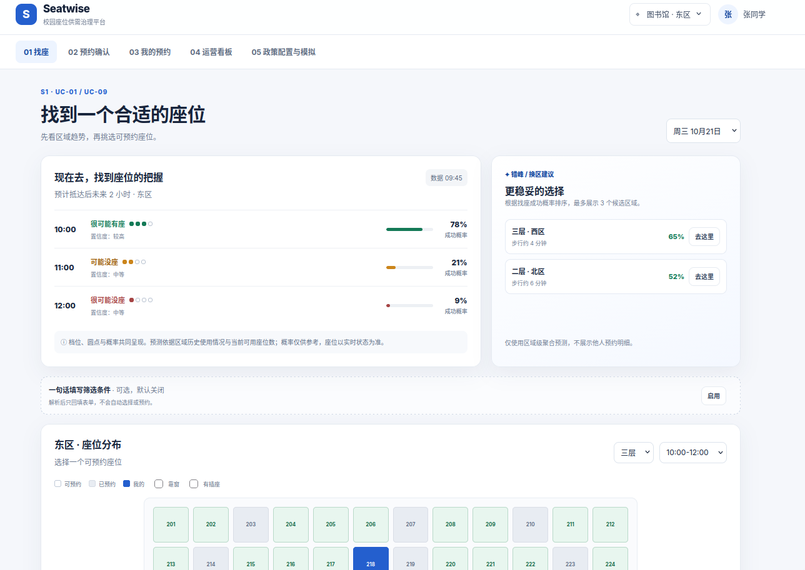

| 组件 | 规格 |
|---|---|
| 概率呈现 | 档位 + 圆点密度 + 百分比三重编码；必带区域、时段、数据时间、`coverage` |
| 数据不足 | 整块替换为“暂无可靠预测”+ 实时座位图，不显示任何数字 |
| 错峰候选 | 最多 3 个，每个附概率、步行距离与一句依据 |
| 代理口径 | 由 WiFi / 门禁推断的值带“估算”标记（R12） |

### 8.2 S2 预约确认（UC-02）

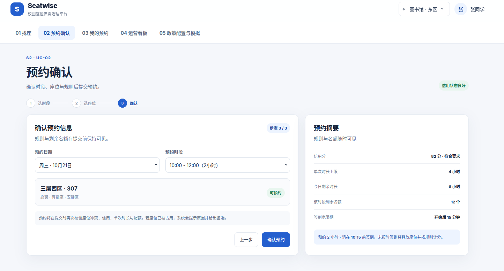

三步内完成。冲突时给 3 个备选，不报错重试；配额已满时给替代时段。

### 8.3 S3 我的预约与签到（UC-03 到 UC-05）

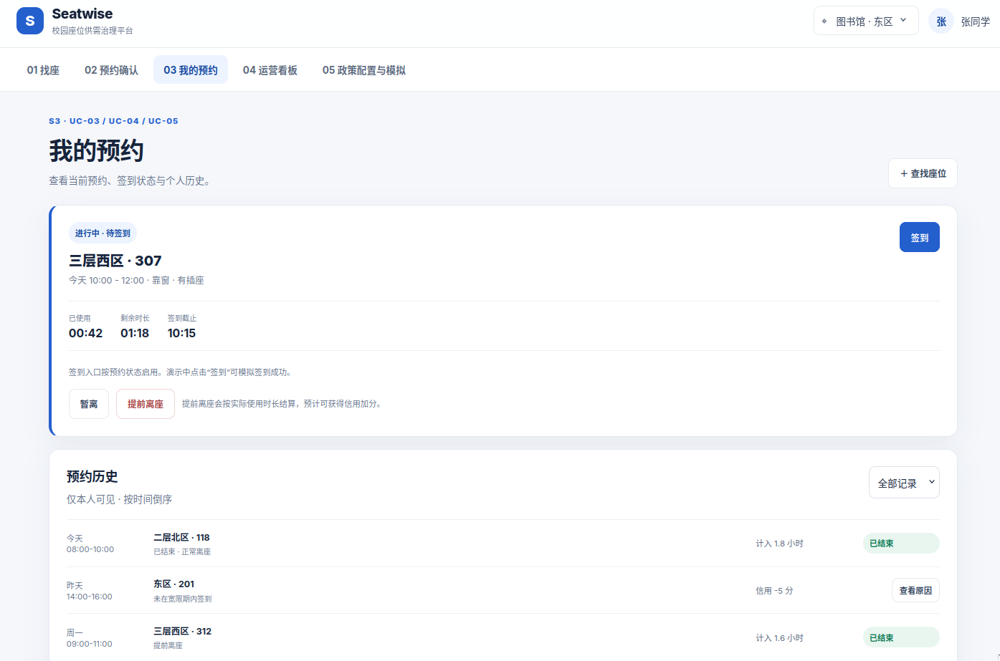

签到 2 次点击，暂离与返回在同一张卡片内，信用变动附原因与规则依据。

### 8.4 S4 运营看板（UC-11）

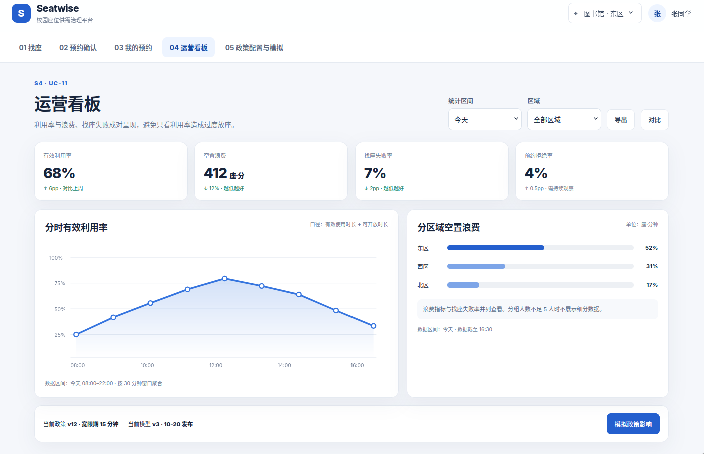

新增楼层失衡指标（最忙除最闲、份额 IQR），并把利用率与浪费并排显示。单看利用率会掩盖“浪费高、总量也高”的区域。

### 8.5 S5 政策配置与模拟（UC-12、UC-14）

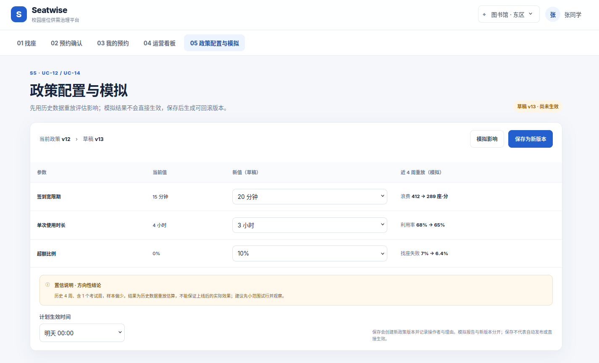

基线列与实验列必须并排，不能折叠；置信说明是必需单元格；置信不足只给方向。参数从 4 项扩到 8 项（R9）：宽限期、时长上限、信用阈值、超额比例、候补容量、确认超时、信用优先档位、峰值轮换间隔。

### 8.6 两条用户流程

学生路径要保证降级优先于精度：外部因素或模型不可用时，页面不显示数字。

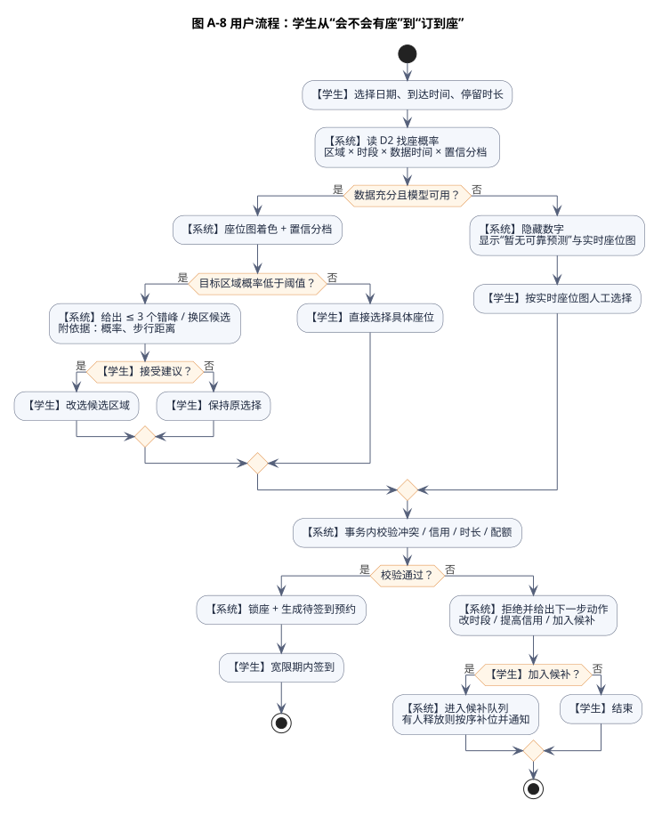

管理员路径要保证模拟不生效：按钮写“保存为新版本”，生效要二次确认，回滚只移动指针。

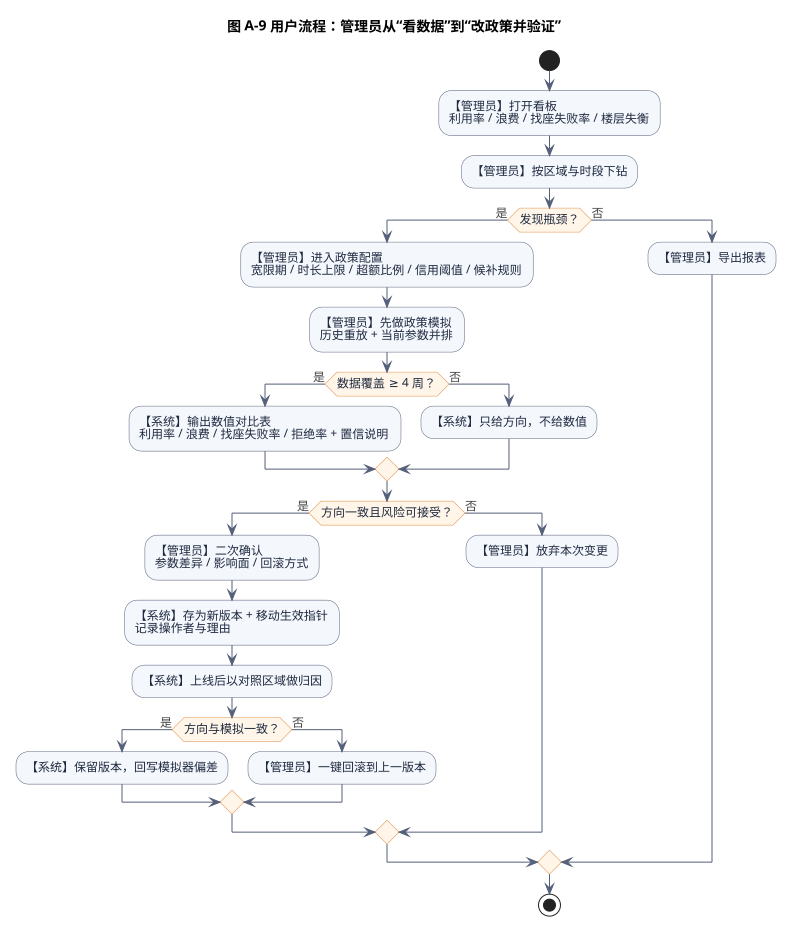

### 8.7 四种降级态

| 状态 | 触发 | 界面表达 |
|---|---|---|
| 预测已关闭 | 特性开关 | 概率区域整体隐藏，留一句说明与实时座位图 |
| 工件回滚中 | 部署中 | 顶部条幅“数据更新中”，禁用概率相关按钮 |
| 数据不足 | `coverage` < 阈值 | “数据不足，仅显示方向”，不给数值 |
| 并发冲突 | 唯一索引冲突 | 409 + 3 个备选 + “该座位刚被占用” |

---

## 9 开放问题与 Part III 验证矩阵

| # | 开放问题 | 为什么现在定不了 | Part III 如何验证 | 不成立就怎么改 |
|---|---|---|---|---|
| 1 | 可迁移比例 θ | 没有真实用户可观测 | 离线反事实回放，对 θ 做参数扫描求盈亏平衡点；再用 8 到 12 人的小样本受控实验给量级区间 | θ 上界低于 0.10 则禁用超额准入，只保留候补 |
| 2 | 座位级冲突的真实水平 | 公开数据只到区域级 | 演示系统上用脚本压测座位级冲突；以区域级“已满”占比（0.1 到 3.3%）作上界参考 | 区域级已满占比长期低于 1%，D2 降级为“仅展示” |
| 3 | 双端打分一致性 | 需实现后对齐 | 同一特征向量在 Python 与 Java 两侧对比 | 误差 > 1e-3 则退回 JSON 系数手写打分（ADR-2 备选） |
| 4 | 在线打分 p95 ≤ 150ms | 需压测 | 加载工件 + 100 并发压测 | 超时则改为批预计算 + 进程内缓存 |
| 5 | 候补队列的公平性 | 优先权规则可能被利用 | 构造“高频取消再候补”的滥用用例 | 加冷却时间与滥用检测 |
| 6 | 信用优先是否加剧不平等 | 需要真实用户分布 | 合成用户代理：按观测到的到达分布生成，服从率取假设区间，跑蒙特卡洛 | 高信用段成功率高出 30 个百分点以上，则改为“仅缩短等待” |
| 7 | 政策模拟的方向一致率 | 没有真实上线 | 历史数据切成前后两段，前段重放、后段对照，算内部方向一致率 | 内部一致率低于 80%，模拟只作讨论材料 |
| 8 | 单体的热点行等待 | 需压测 | 100 并发抢同区域，测 p95 与锁等待 | 出现队列积压则引入按区域分片 |
| 9 | 外部因素端口的真实对接 | 教务系统不对外开放 | 用校历文件 + 手工导出的课表做半自动接入 | 长期不可得则保留手工导入 |

上表中：第 3、4、5、8、9 项交付即可验证；第 1、2、6、7 项依赖真实用户行为，本项目不具备这个条件，只能给出条件化的结论（若 θ 落在某区间则收益为某值），触发条件做成闸门（6.4）。交付物是设计与 PoC 验证。

---

## 10 AI 工具反思、注释文献、成员贡献

### 10.1 AI 工具反思

| 维度 | 内容 |
|---|---|
| 工具链 | Pi agent： 数据检索、脚本生成、图表渲染、文档结构检查；对话式模型：理清思路，备选方案列举 |
| 本轮用途 | 检索并验证候选数据集、生成证据脚本与图表、检查章节对各个要求的覆盖、UML 绘制 |
| 有效之处 | 数据集检索和验证节省了大量人工试错的成本；一些属于“机械但易错”的工作，AI 明显快于人工 |
| 局限 | 会默认数据可得，比如第一版方案直接引用广外数据集，直到实际探测才发现受限；也有可能有错误的认知，比如一开始觉得项目会被实际用户使用、我们能够取得用户数据，声称可以通过观察真实用户的表现来优化表现 |
| 验证方式 | AI 的任何生成都需要进过人工审查；AI 声称跑通的过程一定要人工再跑一遍来确认 |

### 10.2 注释文献

[1] Hong Kong University of Science and Technology Library. “Wi-Fi Connection in HKUST Library.” DataSpace@HKUST, 2015（V9.1，2024-06-13）. DOI: 10.14711/dataset/RQXRQB. 许可：CC0 1.0.

数据源引用。2014 年 2 月到 2022 年 5 月、98 个月的图书馆 WiFi 使用统计，按日乘楼层乘用户群与日乘时段乘用户群两种粒度发布，另有 2020 年 6 月的小时级切片，共 195 个文件。本设计用它三处：提供 8 年的需求结构与季节性，让“楼层失衡 4.0 倍”“日内 65.4% 集中”这类结论有实测依据；8 年跨度包含 2020 年的制度性断点，是漂移检测的直接证据；它的六维质量缺陷（去重口径、封顶、闭馆期）成了数据质量闸门条款的原型。局限是它记的是 WiFi 连接而不是座位占用，人数为设备去重估算（连接数除人数 = 7.79），只能做需求侧口径。

[2] davnas. “real-time-library-occupancy” [KTH 图书馆区域占用数据]. Hugging Face Datasets.

数据源引用。KTH 皇家理工图书馆公开座位看板的结构化抓取，2024-12-09 到 2025-07-31，231 天，95,164 行，6 个区域，约 190 秒一个采样点，容量代理 55 到 100 座。本设计用它做三件事：30 分钟前瞻的基线对照（persistence 0.030、季节朴素 0.082、季节形状乘近期水平 0.035）、概率校准检验（高分段过度自信 13 个百分点）、引导价值的第一个锚点（找座失败率 1.29% 到 0.99%）。使用时注意两点：仓库未声明许可证，仅用于课程内的方法验证，不随代码分发；数据有封顶伪影（值恰为 100 占 0.04% 到 1.3%）与暑期闭馆段，已按闸门截尾剔除。

[3] Hyndman, R. J., Athanasopoulos, G. *Forecasting: Principles and Practice*. 3rd ed. OTexts, 2021.

时序预测的标准教材，本设计从中取了三样东西。基线纪律：任何预测方法都要与朴素方法比较，本书把 persistence 与 seasonal naive 定为最低门槛，这决定了我们第 0 章先跑基线再谈模型的顺序。回测切分规范：固定时间切分、禁止泄漏未来，对应 SRS 7.6.1 的回测方法与 R8 的口径修订。误差度量的选择：MAE 与 MAPE 各有失效场景，因此我们用 MAE 加校准加覆盖率三项描述预测质量，不用单一百分比误差。本书也提示了本设计的盲点：季节性模型在结构断点处会剧烈失效，与 2020 年的实测吻合。

[4] Talluri, K. T., van Ryzin, G. J. *The Theory and Practice of Revenue Management*. Springer, 2004.

收益管理经典。有上限超额准入（L3）来自其超额预订章节：在可取消、可爽约的容量约束下，最优超发量由爽约分布与拒绝成本共同决定，必须有上限与回退条件，否则爽约率下降时会系统性超卖。本书的另一条判据被我们借作验收标准：超额策略的效果看长期平均收益或利用率，不看单日峰值，这也是 BG1 用座·分钟度量的原因。注意本书的收益函数在校园场景不成立（我们没有价格），因此只取其容量控制逻辑，不取定价结论。

[5] Kleppmann, M. *Designing Data-Intensive Applications*. O'Reilly, 2017.

事务、并发控制与幂等语义的主要依据。本设计的写路径（唯一索引拦重复、行锁锁单座、状态断言、幂等键 `(业务键, op, version)`）与“至多一次”的释放语义，对应本书关于唯一性约束、悲观锁与幂等重放的讨论。本书主张用数据库约束表达业务不变式，我们也因此把“不超卖”落在索引与锁上：应用层判断在并发下会失效，约束不会。ADR-3 否决 Redis 分布式锁的理由也在这里，引入外部协调者会把单点故障面扩大，而当前规模下数据库自身的锁足够。

[6] Cunningham, S. *Causal Inference: The Mixtape*. Yale University Press, 2021.

政策归因的方法依据。政策模拟（UC-14）只能给出“若当时采用新参数会怎样”的反事实估计，排除不了同期其他因素，上线后的归因因此用双重差分：以未改政策的对照区域为对照组，检验平行趋势后再给因果结论，否则只描述相关。本书对平行趋势检验、敏感性分析以及“趋势不平行时不要硬做 DID”的强调，直接写成了 SRS 7.6.1 的验收条款。这也是本设计在可解释上的底线：宁可说只是同时发生，也不说因为。

[7] Sculley, D., Holt, G., Golovin, D., et al. “Hidden Technical Debt in Machine Learning Systems.” *NIPS 2015*: 2503–2511.

这篇论文是本项目砍功能的理论依据。它指出 ML 系统的维护成本主要不来自模型代码，而来自数据依赖、配置耦合、管道胶水与边界侵蚀（CACE 原则），功能越多、耦合越深，长期成本越高。据此我们把统计模型收敛为 3 个模型、3 张结果表、2 个决策器，并明确统计模型对业务表只读这一边界，也据此否决了给每个功能都加一个模型的写法。论文关于未声明消费者与数据依赖的警告，对应我们把预测结果与业务类设计成无外键关联（图 D-5）。

[8] Cox, D. R. “Regression Models and Life-Tables.” *JRSS-B* 34(2), 1972: 187–220.

生存分析奠基论文，B1 停留时长模型的方法来源。“已坐一段时间的人还会坐多久”是生存问题：要处理右删失（闭馆时人还在馆里），直接对停留时长做回归会有删失偏差。Cox 比例风险模型的半参数形式使我们不必假设具体分布就能引入时段、区域等协变量。本轮的限制是公开数据只有单次连接时长而不是在馆时长（中位数 17 到 27 分钟），B1 只能用假设分布加 Part III 自有日志标定，这也是第 9 章开放问题 2 的来源。

[9] Roth, A. E. *Who Gets What — and Why: The New Economics of Matchmaking and Market Design*. Houghton Mifflin Harcourt, 2015.

机制设计的通俗入口，第 7 章六条杠杆的理论支撑。反馈 1 问除历史数据外还有没有别的优化方式，本书给的答案是市场设计：资源稀缺且价格不可用时，靠分配规则（优先级、等待队列、配额）改善结果，而不是靠更准的预测。候补队列（L4）按优先级加入队时间排序、不插队，信用优先权（L5）用信誉替代价格，以及“规则必须稳定可解释，否则参与者会策略性行为”这三条都在本书里。它也提醒了 L5 的风险：优先权设计不当会造成马太效应，这是第 9 章的开放问题 6。

[10] Gama, J., Žliobaitė, I., Bifet, A., Pechenizkiy, M., Bouchachia, A. “A Survey on Concept Drift Adaptation.” *ACM Computing Surveys* 46(4), 2014, Article 44.

概念漂移的系统综述，R11 与 7.5 节的方法依据。它把漂移分为突变、渐变、渐进与重复四类：2020 年的需求塌陷是突变（sudden），学期与考试的周而复始是重复（recurring），楼层份额的长期位移是渐变（gradual）。分类决定了检测策略不能只有一种：突变看滚动误差阈值，重复看季节性特征，渐变看份额结构的滑动对比。综述强调的检测、适应、再评估闭环，对应本设计的滚动 MAE 告警、重训与“回测不达标不发布”，也解释了为什么回滚要按正式流程做，而不是当成异常处理。

[11] Schelter, S., Lange, D., Schmidt, P., Celikel, M., Biessmann, F., Grafberger, A. “Automating Large-Scale Data Quality Verification.” *PVLDB* 11(12), 2018: 1781–1794.

数据质量自动化的工程实践，7.4.6（R10）六维闸门的原型。论文主张把数据质量约束写成可执行的检查（完整性、唯一性、取值域、分布约束），在管道每个环节自动验证并阻断，不靠事后抽查。本设计把这条思路落成六个闸门（图 A-7），每次失败写一条质量记录，报表与预测页面据此声明 coverage。实测中最有用的一次发现正是这类检查的结果：楼层求和与 All-Floors 只有 3.15% 相等，没有自动一致性检查，这个语义差异会一路带进利用率报表。

### 10.3 成员贡献
1. 兰昊轩（后端）：负责并发与一致性风险分析、状态机与结算原因梳理。绘制领域类图和状态机图等。
2. 郑执（数据清洗与模型训练）：数据集检索与可达性验证、基于数据集的各项分析。绘制数据管线、外部因素端口、漂移检测图等。
3. 李博瑞（前端和运维）：负责用户流程和降级态梳理、部署与迁移路径分析。绘制用户流程图、界面组件规格、部署架构图等。
