# Seatwise 软件需求规格说明书

校园座位供需治理平台 · 小组 17
兰昊轩（后端 / 预约引擎） 郑执（后端 / AI 与数据） 李博瑞（前端 / 运维）

本文档是 [DESIGN.md](DESIGN.md) 的需求基线。设计文档中的条款引用（如 7.6.1、附录 A）
一律指向本文件。

## 版本历史

| 版本 | 时间 | 内容 | 变更记录 |
|---|---|---|---|
| v1 | Part I 提交 | 首版需求：预约引擎、信用治理、占用预测、对话助手 | — |
| v2 | 提案反馈后 | 定位下沉到决策层；砍掉对话式订座、政策抽取、申诉草拟、运营问答；性能与容量口径下调 | 12.1 节 R1 到 R6 |
| v3 | 作业 2 设计轮（本轮） | 数据源变更；预测验收口径重写；新增候补用例；外部因素与数据质量闸门；漂移检测；代理口径声明 | 12.2 节 R7 到 R12 |

本轮与设计文档的对应关系：制品 4（Updated Requirements）由 12 节的 R7 到 R12 承担，
条款正文的改动散落在 3.5、5.3、7.1.4、7.3.6、7.4.6、7.5.6、7.6.1、7.6.5 与附录 A。

# Seatwise 软件需求规格说明书（SRS）

名称：Seatwise 校园座位供需治理平台

小组：第 17 小组

人员：兰昊轩（后端 / 预约引擎）、郑执（后端 / AI 与数据）、李博瑞（前端 / 运维）

版本：v3（作业 2 设计轮修订，变更 R7 到 R12 见第 12 节；设计文档见 [DESIGN.md](DESIGN.md)）

---

## 1. 目录

1. 目录
2. 引言：产品定位、反馈吸收与团队反思
3. 战略分析：市场判断、竞品矩阵、SWOT、TOWS、业务目标、统计模型与 LLM 出现在哪些功能
4. 路线图：范围与里程碑
5. 用例与业务流程建模：参与者、用例图、用例清单、5 个关键用例规格、4 张流程图、状态机、结算原因枚举
6. 术语表（13 个）
7. 补充说明：可用性、安全、可靠性、性能、可维护性、统计模型与 LLM 专项、验证方式
8. 界面原型（5 个）
9. 参考文献（4 本 + 2 篇 + 3 数据集，均附注释）
10. 团队成员贡献
11. AI 工具反思
12. 变更日志（设计轮修订）
- 附录 A 数据来源

---

## 2. 引言

### 2.1 产品定位

本文档定义 Seatwise 的软件需求，面向评审教师、开发者与（模拟的）场馆方管理员。

校园座位预约已经商品化，选座、签到、超时释放都是成熟功能，再做一个既无差异化也无设计挑战。稀缺座位如何分配与治理，场馆方却没有量化依据：放多少座、放多久、高峰何时收紧、爽约如何处置、一条新规上线后究竟变好还是变坏，都只能凭经验。

因此 Seatwise 定位为座位供需的决策层。预约、签到、释放是必要的底座（本系统自建；有效数据取两份公开数据，HKUST 图书馆 WiFi 使用统计做需求侧、KTH 图书馆区域占用做占用侧，见附录 A），其上做三类能力：短时占用与找座概率预测；基于预测的准入与引导，含错峰推荐、动态释放与有上限的超额准入；治理政策的效果模拟与归因。系统要回答两个今天答不了的问题。“周三上午十点去东区还找得到座吗？”找座页给出带数据时间的概率。“把签到宽限期从 15 分钟改成 20 分钟，浪费会降还是升？”政策模拟器输出对比表与置信说明。

### 2.2 反馈吸收与团队反思

提案提交后的反馈集中在三点：场景陈旧，校内预约系统已能满足基础需求；没有说明这个场景为什么要用 AI，有些用法反而增加成本与维护难度；时序预测有价值，对话意义不大。

我们接受这三点，做了三处调整：定位从“再做一个预约系统”下沉到决策层，差异化放在预测、准入与政策评估上（3.1、3.2）；逐场景判定哪些功能才用统计模型或 LLM，只保留规则与表单都失效的地方（3.6）；对话退出产品重点，能力收敛为预测与决策链，订座、扣分、释放等确定性动作不引入模型，LLM 只留一个可选的“自然语言转检索参数”适配层，表单仍是主入口（3.6、L1）。

---

## 3. 战略分析

### 3.1 市场判断

同类产品（校内图书馆预约系统、通用场馆预约平台、LibCal 类空间管理系统）在选座、签到、简单信用规则这一层高度同构，差异只在集成方式与价格。缺陷也一样：系统记录谁订了哪张椅子，却不回答这里还需要多少椅子、什么时候需要、现在的规则是否有效。

“应用场景陈旧”在这一层成立。我们的改动是承认预约是底座，把差异化放在预测、准入与政策评估上，并用 3.2 的矩阵把它写成可检验的差距。

### 3.2 竞品能力矩阵

图例：✓ 具备；△ 部分；✗ 不具备；里程碑编号（M1～M5）见 4.2 的里程碑表。

| 能力 | 校内预约系统 | 通用预约平台 | LibCal 类 | Seatwise | 里程碑 |
|---|---|---|---|---|---|
| 选座预约 / 签到释放 | ✓ / ✓ | ✓ / △ | ✓ / ✓ | ✓ / ✓ | M1 |
| 违规与信用治理 | △ 简单计数 | ✗ | △ | ✓ 可解释 | M2 |
| 占用与找座概率预测 | ✗ | ✗ | ✗ | ✓ | M3 |
| 基于预测的准入与超发 | ✗ | ✗ | ✗ | ✓ 有上限、可回退 | M4 |
| 政策模拟与效果归因 | ✗ | ✗ | ✗ | ✓ | M4 |
| 扣分与推荐的原因解释 | ✗ | ✗ | ✗ | ✓ | M2～M3 |
| 核心流程无外部依赖 | ✓ | ✓ | △ 云托管 | ✓ 可选 NL 层除外 | — |

### 3.3 SWOT

| | 有利 | 不利 |
|---|---|---|
| **内部** | **S** 图书馆行为数据可直接训练与回测，政策假设能被检验；统计模型只做预测与建议，不碰写操作 | **W** 占用靠行为推断，没有直接感知；座位号可能脱敏，只能到区域级；缺政策文本与申诉记录 |
| **外部** | **O** 场馆开始被考核利用率与公平性，需要可解释的决策依据；同类产品只做预约，预测与政策评估普遍缺失；建模与数据工具成熟，小团队也能落地 | **T** 现有系统已满足基础预约，新增系统必须有硬理由；隐私与数据使用受合规限制；流程或开放时间一变，历史规律即失效 |

### 3.4 TOWS 策略

| 组合 | 策略 | 里程碑 |
|---|---|---|
| SO | 用数据闭环做“政策实验台”：预测 + 基线对照 + 政策模拟 | M3、M4 |
| ST | 不替代预约系统，只做决策层，渠道可对接 | M1、M4 |
| WO | 用现有数据集训练，模拟器只补缺失维度 | M3 |
| WT | 主动砍范围，统计模型与 LLM 全线可降级 | M5 |

### 3.5 业务目标与举措

基线取 HKUST 图书馆 WiFi 使用统计[8]（2014 年 2 月到 2022 年 5 月，98 个月、2,981 天）按楼层 × 时段 × 日聚合，占用侧回测取 KTH 区域占用[9]（231 天、6 区域、约 190 秒粒度）。两份数据用于训练、基线、回测与漂移检验；政策模拟的重放事件在 Part III 由自建系统日志提供。实测口径与数字见设计文档第 0、6 章。

| 编号 | 目标 | 指标 | 目标值 | 举措（组件） | 里程碑 |
|---|---|---|---|---|---|
| BG1 | 提高有效利用率 | 有效使用时长 ÷ 可开放时长 | **+5%**（中性档；区间 +1.8%～+11.0%，推导见设计文档 6.2） | UC-01/09、UC-18，D2 + 机制杠杆 | M3/M4 |
| BG2 | 降低空置损失 | 浪费座·分钟 ÷ 可开放座·分钟 | −30% | UC-06、UC-12，D3、C1 | M2/M4 |
| BG3 | 政策可评估 | 一次评估的周期 | ≤ 1 天 | UC-11/14，S5、C3 | M4 |
| BG4 | 降低“到场无座” | 找座失败率 | −25% | UC-01/09，D2 校准 | M3 |
| BG5 | 缩短申诉处理 | 平均处理时长 | −50% | UC-07/13 | M2 |

### 3.6 统计模型与 LLM 出现在哪些功能

只有规则与表单都失效的地方才用统计模型或 LLM[6]，下表是全部位置，未列入的一律用确定性规则或表单实现。统计模型与 LLM 分别决策，判定标准不同。组件编号在全文通用。

| 编号 | 组件 | 出现在哪个功能 | 输入 → 输出 | 写权限 |
|---|---|---|---|---|
| B1 | 停留时长模型 | UC-01/09 的占用轨迹 | 时段、区域、历史停留 → 时长分布（生存分析 [7]） | 无 |
| B2 | 签到/爽约模型 | UC-11/12 的浪费估计 | 提前时距、历史行为 → 不签到概率 | 无 |
| B3 | 需求模型 | UC-01 的找座预测、UC-12 的配额 | 周次、课表、考试周 → 到达分位数 | 无 |
| D1 | 占用轨迹分布 | UC-01 | 当前占用 + B3 − B1 → 区域×时段分布 | `occupancy_prediction` |
| D2 | 找座成功概率 | UC-01、UC-09 | D1 + 可用座位数 → 概率、置信分档与覆盖度（含 `feature_as_of` / `model_version`，见 7.1.4） | `occupancy_prediction` |
| D3 | 期望浪费 | UC-11、UC-12 | B2 + B1 + 座位数 → 座·分钟 | `waste_estimate` |
| C1 | 配额与超发建议 | UC-12（人工采纳后生效） | D3 + D1 上分位 → 建议超发量 | 无 |
| C2 | 引导排序 | UC-09 | D2 + 步行距离 → ≤ 3 个候选 | 无（仅展示） |
| C3 | 政策模拟与归因 | UC-14 | 模拟器 + 历史日志 + 参数组合 → 对比表与置信 | `simulation_report` |
| L1 | 自然语言适配（可选 P2） | UC-17 | 一句话描述 → 筛选参数 | 无（回填表单） |
| A1 | 异常检测（可选 P2） | UC-11 的线索 | 请求规律性、设备特征 → 异常分 | 无（不触发处置） |

两条边界：统计模型对业务表只读，只能写 `occupancy_prediction`、`waste_estimate`、`simulation_report` 三张结果表；预约、扣分、释放、配额由确定性服务或人执行。LLM 不接触业务表，只回填表单。数据不足或模型不可用时不显示数字，退回规则版（7.3.4、7.6.1）。

---

## 4. 路线图

### 4.1 范围与明确的非目标

取舍标准：能否在演示中证明决策层优于规则层。

| 优先级 | 内容 |
|---|---|
| P0 必须 | 预约状态机、签到、超时释放、信用计分、申诉工单（表单 + 模板）、管理看板、找座概率与错峰建议、模型训练发布 |
| P1 尽力 | 期望浪费估计、有上限的超额准入[3]、政策模拟与归因 |
| P2 可选 | 异常行为检测、加开区域与排班建议、自然语言接口 |

非目标：对话式助手、政策文本抽取、申诉草拟、运营问答（3.6）；摄像头与传感器检测；与真实校方系统对接；多校区、支付、原生 App；统计模型或 LLM 自动执行有副作用的动作。

### 4.2 里程碑与退出准则

S0（10/18～10/23）：SRS 定稿、契约首版、仓库骨架。下表中时间节点为预估节点，后续可能调整。

| 阶段 | 时间 | 内容 | 退出准则（可验证） |
|---|---|---|---|
| M1 | 10/24～11/06 | 预约引擎：状态机、事务 + 行锁、幂等释放、签到 | 100 并发 0 超卖；释放重复 100 次结果一致；预约 3 步内完成 |
| M2 | 11/07～11/20 | 信用治理、管理后台、报表、申诉（表单 + 模板） | 5 条计分规则可配；3 张报表可导出；申诉闭环且留痕 |
| M3 | 11/21～12/04 | 数据集接入与清洗、B1～B3、找座概率与建议、回测与校准、模拟器补缺失维度 | 日粒度需求预测相对 persistence 提升 ≥ 20%；30 分钟前瞻不劣于 persistence 10%；分档校准偏差 ≤ 5pp；覆盖率 ≥ 90%（见 R8） |
| M4 | 12/05～12/18 | 期望浪费、超额准入、政策模拟与归因、开关与回退 | 产出一份“宽限期 15→20 分钟”模拟报告；配额上限可一键关闭；回退不丢数据 |
| M5 | 12/19～01/08 | 指标全量测量、降级、（可选）异常检测与自然语言参数解析、演示与报告 | 7.7 每项有结果；关闭模型与 LLM 演练下主流程可完成；每个 BG 有前后对比 |

---

## 5. 用例与业务流程建模

### 5.1 参与者

| 参与者 | 关注点 |
|---|---|
| 学生 | 能不能坐上；为什么被扣分；如何申诉 |
| 场馆管理员 | 利用率与浪费；政策效果；申诉处理 |
| 运维 | 模型发布与回滚；开关、审计与告警 |
| 统一身份认证（外部） | 校园账号登录，演示环境以本地账号替代 |
| 定时任务（系统） | 超时释放、数据聚合、批量训练与预测预计算 |

### 5.2 用例图

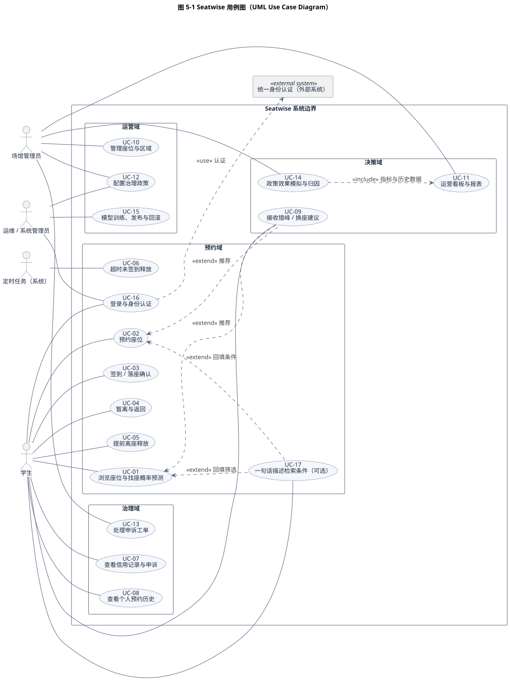

> 图 5-1 为 UML 用例图；参与者与用例的完整清单见 5.3。

### 5.3 用例清单

| 编号 | 用例 | 参与者 | 简明描述 | 优先级 |
|---|---|---|---|---|
| UC-01 | 浏览座位与找座概率预测 | 学生 | 选择日期与区域，查看座位图与未来 2 小时“到点能否找到座”的概率，并给出更可能有座的区域排序。数据不足时显示“暂无可靠预测”。 | P0 |
| UC-02 | 预约座位 | 学生 | 在规则约束下选座并提交，系统在事务内校验冲突、信用、时长与配额，成功后锁定座位并生成待签到预约。 | P0 |
| UC-03 | 签到 / 落座确认 | 学生 | 宽限期内扫码或点击签到，服务端校验预约归属与座位一致，成功后进入“使用中”。 | P0 |
| UC-04 | 暂离与返回 | 学生 | 登记暂离后保留座位，超时未返回则释放并记一次违规。 | P1 |
| UC-05 | 提前离座释放 | 学生 | 主动结束使用，座位立即回收；按实际时长结算并给予信用加分。 | P0 |
| UC-06 | 超时未签到释放 | 定时任务 | 扫描过期待签到预约，条件更新后释放座位、记爽约并扣分；幂等，可重放。 | P0 |
| UC-07 | 查看信用记录与申诉 | 学生 | 查看信用分、计分明细与规则依据；对争议扣分选择原因类型并提交申诉。 | P0 |
| UC-08 | 查看个人预约历史 | 学生 | 按时间查看已完成、已取消、已爽约记录与时长统计，仅本人可见。 | P1 |
| UC-09 | 接收错峰 / 换座建议 | 学生 | 依据找座概率给出 ≤ 3 个候选建议并附依据；用户可接受、忽略或关闭。 | P0 |
| UC-10 | 管理座位与区域 | 场馆管理员 | 维护区域、座位、开放时段与临时闭馆，支持批量导入与停用，写审计。 | P0 |
| UC-11 | 运营看板与报表 | 场馆管理员 | 查看利用率、浪费、找座失败率、违规分布，可按区域与时段下钻并导出；报表读分钟级物化汇总表（7.4.4），口径与 BG1–BG5 一致。 | P0 |
| UC-12 | 配置治理政策 | 场馆管理员 | 表单设置宽限期、时长上限、信用阈值、超额比例等，做取值域与冲突校验，保存为可回滚版本。 | P0 |
| UC-13 | 处理申诉工单 | 场馆管理员 | 查看结构化事实与规则快照，按模板生成并编辑回复；撤销扣分需显式确认，全程留痕。 | P0 |
| UC-14 | 政策效果模拟与归因 | 场馆管理员 | 在历史数据上重放新参数，输出利用率、浪费、找座失败率、拒绝率对比；上线后用对照区域做归因。数据不足时只给方向。 | P1 |
| UC-15 | 模型训练、发布与回滚 | 运维 | 触发离线训练，查看回测（基线对照、校准、覆盖率），通过后灰度发布；劣化时一键回滚。 | P0 |
| UC-16 | 登录与身份认证 | 全部 | 统一认证登录并按角色授权；失败锁定、会话超时、越权拒绝并记录。 | P0 |
| UC-17 | 一句话描述检索条件（可选） | 学生 | 用一句话描述条件（如“下午两点、靠窗、两小时”），系统解析为筛选参数并回填表单，用户确认后提交。解析失败或置信度低时回退纯表单；默认关闭，可在设置中启用。 | P2 |
| UC-18 | 候补队列与自动补位 | 学生 / 定时任务 | 预约被拒或区域已满时可加入候补；座位释放时按“优先级 + 入队时间”取首个条目，生成待确认预约并通知，超时未确认顺延下一位。候补不是预约状态，不锁座。 | P1 |

### 5.4 关键用例规格

选 5 个覆盖主要风险点（并发、幂等、预测质量、人工确认、反事实评估）的用例给出规格，其余见 5.3。

| 用例 | 前置条件 | 主成功场景 | 关键规则与异常 |
|---|---|---|---|
| UC-02 预约 | 已登录未封禁；信用 ≥ 60；无进行中预约 | 选时段 → 看座位与 D2 → 提交；事务内行锁校验冲突/信用/时长/配额；写待签到预约并锁座 | 单次 ≤ 4h、日 ≤ 8h、同座同时段唯一、宽限 15 分钟、爽约扣 5 分；已占则推荐 3 个备选；配额满给替代时段 |
| UC-06 超时释放 | 存在过期未签到预约 | 取一批（≤ 200）→ 条件更新 → 置爽约/释放/写账本 → 通知 | 幂等键 = `(预约号, reason=NO_SHOW, 政策版本)`；已签到则跳过；中断可续跑，不重复扣分 |
| UC-09 错峰建议 | 该区域有可用 D2 | 读概率 → 低于阈值生成 ≤ 3 个候选 → 附依据展示 → 接受则跳转预约 | 仅用聚合预测，不读他人预约；模型不可用则隐藏建议；只给分档不给裸概率 |
| UC-12 政策配置 | 有管理权限；存在生效版本 | 改参数 → 取值域与冲突校验 → 高风险二次确认 → 存为版本 → 提示可先模拟 | 参数白名单；变更需版本 + 操作者 + 理由；回滚只移动生效指针 |
| UC-14 政策模拟 | 数据覆盖待评估区间（≥ 4 周） | 选参数 → 重放对比 → 输出利用率/浪费/找座失败/拒绝率 + 置信 → 存报告 | 必须与当前参数并排；数据不足只给方向；结果不直接生效 |

### 5.5 主业务流程

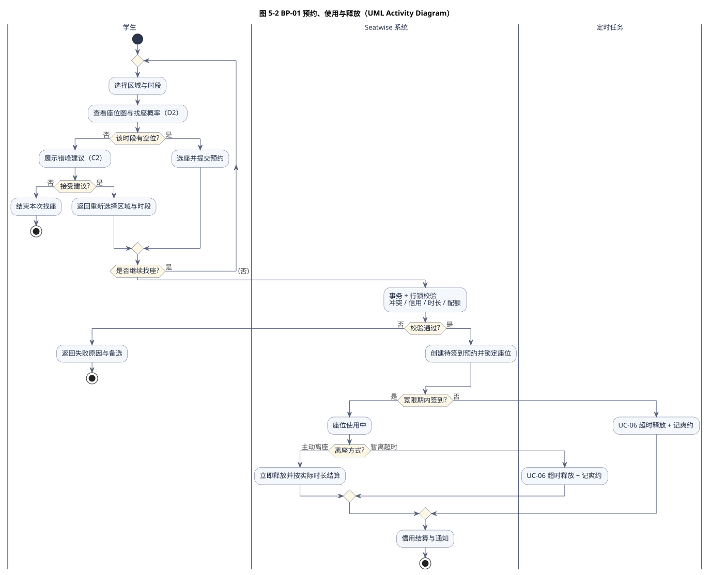

图 5-2 BP-01 预约、使用与释放。统计模型只以“概率转建议”的方式出现，不参与校验与写入。

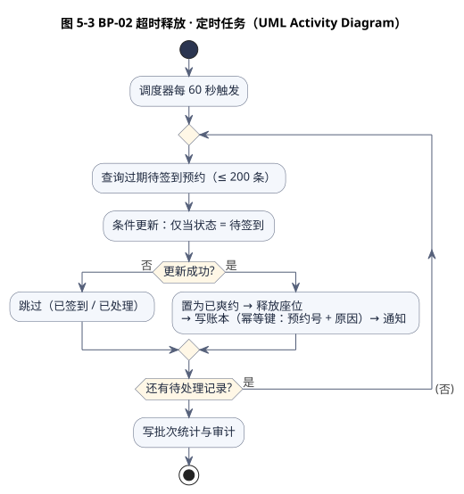

图 5-3 BP-02 超时释放（定时任务）。条件更新与账本幂等键共同保证至多一次，任务可安全重放。

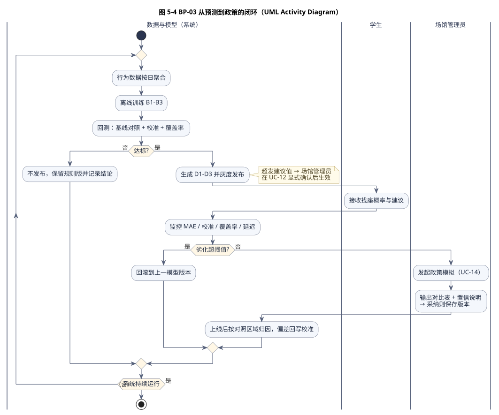

图 5-4 BP-03 从预测到政策的闭环。预测只产出建议值，配额与政策必须经 UC-12 由人确认；偏差回写让模拟器本身也被检验。

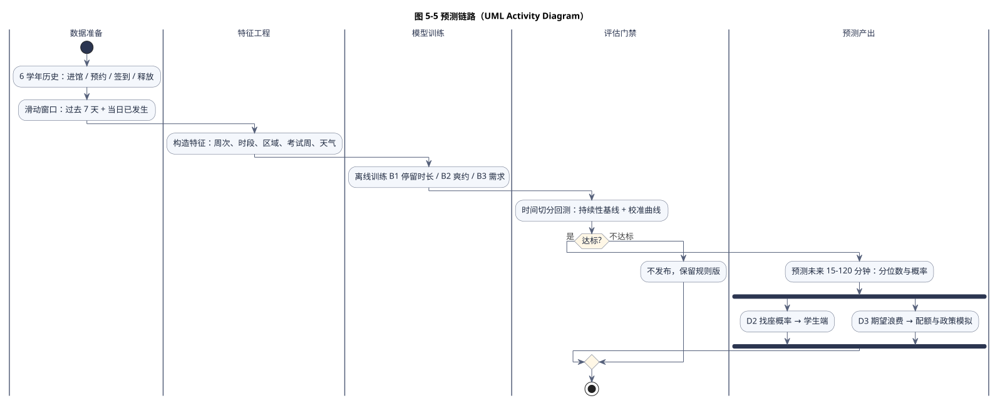

图 5-5 预测链路（时序）。历史行为经滑动窗口与日历特征进入 B1 到 B3，只有通过回测与校准的模型才生成 D2/D3；未达标不发布，页面回到规则版。

### 5.6 座位预约状态机

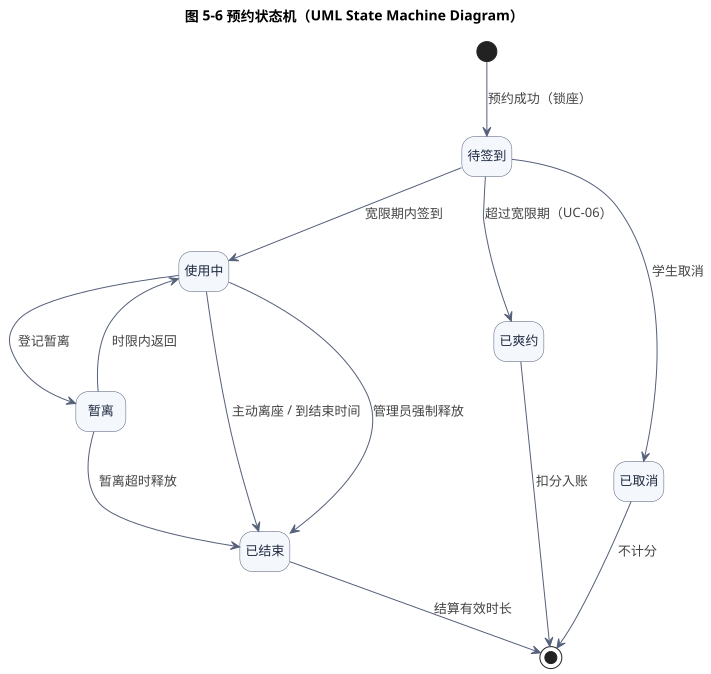

图 5-6 预约状态机。状态迁移是并发与幂等的唯一判定依据：写操作要求当前状态符合预期，因此同一事件重复到达只产生一次效果。

### 5.7 结算原因（reason）枚举

状态只回答现在是什么，结算原因回答为什么结束。账本记账与幂等键都以原因为键，所以原因是受控枚举，不是自由文本；新增类别必须同时更新本节与 7.3.1。

| 代码 | 成因 | 触发用例 | 座位处理 | 计分 |
|---|---|---|---|---|
| `CHECK_OUT` | 学生主动离座 | UC-05 | 立即释放 | 按实际时长结算，良好行为加分 |
| `SESSION_END` | 到达结束时间 | UC-05 / 定时 | 到期释放 | 正常结算 |
| `AWAY_TIMEOUT` | 暂离超时未返回 | UC-04 | 释放 | 记一次违规 |
| `NO_SHOW` | 超过宽限期未签到 | UC-06 | 释放 | 扣分 |
| `FORCED_RELEASE` | 管理员强制释放 | UC-10 | 释放 | 不自动计分，需留痕与理由 |
| `USER_CANCEL` | 学生取消预约 | UC-02 | 释放 | 不计分 |

说明：状态机图（图 5-6）的迁移标签不需要改。`已结束` 的多种来源与上述代码一一对应，图的粒度是状态，本节补的是状态之下的成因。

---

## 6. 术语表

| # | 中文 | 英文 | 定义 |
|---|---|---|---|
| 1 | 区域 | zone | 一组座位单元的集合，是预测、准入与统计的基本单位 |
| 2 | 时段 | slot | 可预约的时间片，默认 30 分钟，长度可配 |
| 3 | 预约 | booking | 学生占用某座位某时段的权利与事实记录，含状态机（5.6） |
| 4 | 签到 | check-in | 宽限期内确认到场的动作，使预约进入“使用中” |
| 5 | 宽限期 | grace period | 预约开始后仍允许签到的时长，默认 15 分钟，可配 5～30 分钟 |
| 6 | 爽约 | no-show | 超过宽限期未签到、座位被回收的事实，触发扣分 |
| 7 | 释放 | release | 座位由“被占用”变为“可预约”的状态迁移，含主动离座、暂离超时、超时未签到、管理员强制与取消五种来源（5.7），必须幂等 |
| 8 | 信用分 | credit score | 由计分规则累积得到的信誉值，影响可约时段与时长；由信用账本追加事件派生，不是可直接写入的字段 |
| 9 | 治理规则 / 政策 | policy rule | 约束预约与释放行为的一组可配置参数与计分规则，版本化、可模拟、可回滚 |
| 10 | 找座成功概率 | find-seat probability | 给定区域、到达时间与停留时长，到场后能找到空位的概率（D2），本系统核心预测目标 |
| 11 | 期望浪费 | expected waste | 因爽约与提前离座造成的空置量，单位“座·分钟”（D3） |
| 12 | 校准 | calibration | 预测概率与实际发生频率的一致程度，用于判断概率是否可信（7.6.1） |
| 13 | 自然语言适配层 | NL adapter | 把一句话解析为检索参数的可选组件（L1），只回填表单、不执行预约，失败即回退表单 |

---

## 7. 补充说明（非功能需求）

数值目标以演示场馆（3 区域 × 约 400 座，08:00～22:00）为基准；验证手段见 7.7。

### 7.1 可用性

| 编号 | 需求 |
|---|---|
| 7.1.1 | 新用户无需说明即可完成预约：5 人测试成功率 ≥ 80%，首次完成 ≤ 60 秒 |
| 7.1.2 | 表单预约 ≤ 3 步、≤ 5 次点击；签到 ≤ 2 次点击 |
| 7.1.3 | 每个系统决定（扣分、拒绝、释放、推荐）可展开查看原因与依据；错误提示给出下一步动作 |
| 7.1.4 | 预测呈现必须带“区域 + 时段 + 数据时间 + 置信分档”，不得只给裸概率；数据不足时不显示数字。落到字段是 `zone` / `slot` / `feature_as_of` / `model_version` / `band` / `coverage` 六项，接口缺任一项即视为口径不完整。**任何由 WiFi、门禁或传感器推断的人数必须标注“代理口径”，不得与座位占用混称**（R12） |
| 7.1.5 | 满足 WCAG 2.1 AA：键盘可达、对比度 ≥ 4.5:1、图表不只依赖颜色；375 px 宽度可用，3G 首屏 ≤ 3 秒 |

### 7.2 安全

| 编号 | 需求 |
|---|---|
| 7.2.1 | 统一认证 + RBAC 三角色（学生、管理员、运维），默认最小权限；越权返回 403 并写审计 |
| 7.2.2 | 预约与签到接口按“用户 + IP”限流（默认 10 次/分钟），防脚本抢座；座位码含签名与有效期，拒绝代签 |
| 7.2.3 | 政策与配额变更需版本号、操作者、理由与二次确认，缺失即拒绝 |
| 7.2.4 | 个人信息加密存储、日志脱敏；密钥只从环境变量读取；数据库访问全部参数化 |
| 7.2.5 | 预测与模拟使用独立的只读数据库账号，对业务表只读、只写三张结果表（3.6）。实现为双数据源：业务写账号负责 `booking` / `credit` / `policy`，预测只读账号负责读业务视图与写结果表；在线打分的输出同样只落结果表，不写业务表 |
| 7.2.6 | 信用分只能由信用账本的追加事件派生，任何接口不得直接写分数；更正只能追加一条冲正记录 |

### 7.3 可靠性与降级

| 编号 | 需求 | 通过标准 |
|---|---|---|
| 7.3.1 | 预约、签到、释放、扣分四类写操作全部幂等[4] | 幂等键 = `(业务键, op, version)`，唯一索引落库；同一请求重复 100 次，结果与执行 1 次一致 |
| 7.3.2 | 并发不超卖 | 100 并发抢同区域：重复分配 0 例 |
| 7.3.3 | 状态与账本最终一致 | 补偿任务 5 分钟内对齐，不一致有告警 |
| 7.3.4 | 全线降级 | 关闭全部统计模型与 LLM 后，预约、签到、释放、计分、报表仍可用（演练验收） |
| 7.3.5 | 回滚时限 | 政策回滚 ≤ 1 分钟、模型回滚 ≤ 10 分钟，且不丢数据 |
| 7.3.6 | **漂移检测与再训练触发**（R11） | 滚动 MAE 连续 5 天超阈、楼层份额或用户群构成位移超阈、外部因素端口失联 ≥ 7 天，任一条触发告警；重训未通过回测不发布；触发到回滚完成 ≤ 10 分钟 |

### 7.4 性能与容量

指标按演示场馆的日均预约量推导：3 年 100 万条预约对应日均约 913 次；整点换场的高峰 10 分钟约占当日 25%，平均约 0.4 req/s。验收取 100 并发与 20 req/s，含数十倍余量；压测目的是验证一致性（不超卖、幂等），容量不对应真实峰值的严格上限。该口径由设计阶段下调，原因见 12 节 R6。

| 编号 | 需求 | 指标 |
|---|---|---|
| 7.4.1 | 常规接口延迟 | p95 ≤ 300 ms，p99 ≤ 800 ms |
| 7.4.2 | 预测查询延迟 | p95 ≤ 150 ms（预计算 + 缓存） |
| 7.4.3 | 吞吐 | ≥ 20 req/s，按 100 并发压测 |
| 7.4.4 | 容量 | 400 座 × 28 时段/日；3 年约 100 万条预约。训练与回测的主表为“区域 × 30 分钟 × 日”聚合，约 18 万行。报表读分钟级物化汇总表，≤ 2 秒；汇总口径与 BG1–BG5 的定义一致，口径变更须同步汇总任务 |
| 7.4.5 | 离线任务 | 训练 ≤ 30 分钟、回测 ≤ 20 分钟、4 周政策模拟 ≤ 60 秒 |
| 7.4.6 | **数据质量六维与闸门**（R10） | 完整性（日期覆盖 ≥ 95%，缺失打标记不插值）、一致性（分组求和 = 总量；**总量为去重值，楼层值不得相加**）、有效性（闭馆期与封顶伪影剔除）、唯一性（(日期, 层级, 群体) 无重复）、时效性（`feature_as_of` 与数据区间必填）、覆盖度（有外部因素的区域×时段占比 ≥ 90%）。每道闸门失败须写一条质量记录（维度 / 影响行数 / 处置），报表与预测页面据此声明 `coverage` |

### 7.5 可维护性与可观测性

| 编号 | 需求 |
|---|---|
| 7.5.1 | 契约先行：OpenAPI 为唯一契约来源，与实现同 PR 更新；分层不绕层，关键路径分支覆盖 ≥ 80% |
| 7.5.2 | 治理参数全部配置化，热更新 ≤ 1 分钟生效，无需发版 |
| 7.5.3 | 模型版本化：模型、特征、训练数据区间、评估指标四位一体可追溯，回滚 ≤ 10 分钟 |
| 7.5.4 | 无外部模型依赖；预测与模拟在本机完成，接口经适配层隔离以便替换实现 |
| 7.5.5 | 结构化日志含 traceId 且不含个人信息；指标覆盖找座失败率、预测 MAE、校准偏差、覆盖率、延迟；写操作与模型变更留审计 ≥ 180 天 |
| 7.5.6 | **结构变更留痕**（R11）：楼层份额、用户群构成、区域容量等结构性指标按周入库并可回溯，供漂移对比与政策归因使用 |

### 7.6 统计模型与 LLM 专项

#### 7.6.1 准确性与可靠性

| 能力 | 可接受错误率 | 验证方法 |
|---|---|---|
| 日粒度需求预测（区域 × 日） | **相对 persistence 提升 ≥ 20%**；MAE ≤ 8pp 仅作报告指标 | 固定时间切分回测（禁泄漏未来）+ 线上滚动 MAE [2] |
| 占用预测（30 分钟前瞻，D1） | **不劣于 persistence 10%**；覆盖率 ≥ 90% | 同左；实测 persistence 已低至 0.030，故不再要求相对提升 [2] |
| 找座概率（D2） | 分档校准偏差 ≤ 5pp；Brier 优于“按历史频率的常数预测” | 校准曲线 + 分档命中率，按区域分层 |
| 期望浪费（D3） | 相对误差 ≤ 25%（按周聚合） | 与实测浪费座·分钟按周对比 |
| 政策模拟（C3） | 上线后方向一致率 ≥ 80% | 模拟 vs 实测的后验对比，每学期 ≥ 1 次 |
| 归因（DID） | 对照区满足平行趋势检验，否则不出因果结论 | 趋势检验 + 敏感性分析 [5] |
| 自然语言解析（L1） | 字段级准确率 ≥ 95%（区域、时段、时长、属性）；无法确定时必须弃权而非猜测 | 50 条标注句逐字段比对 + 弃权率统计 |

回测集、评估区间与剔除规则：闭馆、限流与制度性断点（如 2020 年）作为异常区间剔除或单独作为漂移检验集，并在报告中注明。

#### 7.6.5 外部因素接入（R10）

校历、考试周、假期与课表经 `AcademicCalendarPort` 进入特征管线，取不到时按无外部因素降级，把 `coverage` 标记为不足，不生成数字。实测依据是外部因素把日需求的解释力从 R²=0.177 提到 0.434（再加学期第几周 0.452），且考试期需求低于学期内，说明日历编码要来自真实校历，不能按经验假设写。统一原则：宁可拒答，不可错答；数据不足或模型不可用时隐藏数字并提示“暂无可靠预测”，任何结果都附数据时间与口径。

#### 7.6.2 延迟与成本

| 项 | 指标 |
|---|---|
| 在线推理 | 预测查询 p95 ≤ 150 ms；批量预计算每 15 分钟一批、单批 ≤ 60 秒 |
| 离线任务 | 训练 ≤ 30 分钟；4 周政策模拟 ≤ 60 秒 |
| 成本 | 预测类无外部调用费用，单机 CPU 完成；L1 仅在用户主动点击时调用，单次 ≤ ¥0.01，超月预算自动关闭 |

#### 7.6.3 自主性

| 可无人监督执行 | 必须人工确认后执行 |
|---|---|
| 离线训练与回测、批量预计算、生成预测与建议值、生成模拟报告、自然语言解析并回填表单草稿 | 发布模型版本、修改配额与政策、取消预约、扣分或封禁 |

#### 7.6.4 隐私与数据治理

- 数据分级：预约明细与身份信息属“个人”，不出校园边界；除可选的自然语言适配层（只发送查询文本、可关闭）外，不向任何第三方发送。
- 训练只用聚合特征，不保留姓名学号，用户 ID 单向散列。
- 数据集使用前二次脱敏（去除姓名与学号、卡号散列、去掉可定位到个人的时间戳精度），不导出校园网；对外报告只呈现聚合结果。
- 任何界面与模型输出不得包含他人预约明细；聚合结果最小分组 ≥ 5 人，防反推。
- 保留期：预约明细 180 天、审计 1 年；学生可查询本人记录（UC-07/08）。

### 7.7 验证方式

| 对象 | 手段 | 阶段 |
|---|---|---|
| 并发不超卖、幂等 | 100 并发压测；重复调用 ×100 | M1 |
| 预测精度与校准 | 离线回测 + 校准曲线 + 基线对照 | M3 |
| 统计模型只读隔离 | 用预测服务账号尝试写业务表，应全部被拒 | M3 |
| 延迟与吞吐 | 压测报告 p95/p99 与 RPS | M3 |
| 模拟与归因 | 一次完整模拟 + 上线后偏差对比 | M5 |
| 降级与回滚 | 关闭统计模型与 LLM / 断网演练；政策与模型各回滚一次 | M4/M5 |
| 可用性 | 5 人可用性测试 | M2 |

---

## 8. 界面原型

低保真线框，重点是决策信息如何呈现。本系统不设聊天页面，统计模型只以概率、档位与对比表嵌入既有流程；可选的自然语言输入是表单旁的快捷入口，默认关闭。申诉页结构简单（事实、规则快照、模板回复），不单独出图。

### 8.1 S1 找座（UC-01、UC-09）
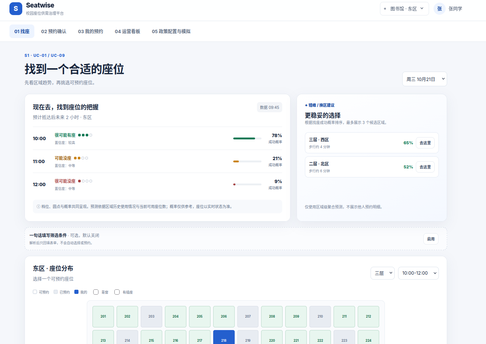

### 8.2 S2 预约确认（UC-02）
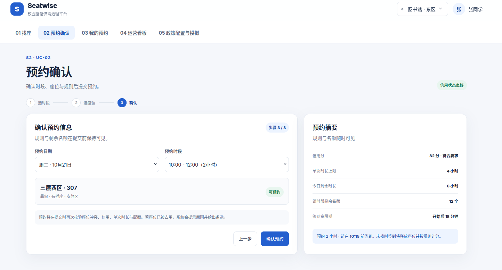

### 8.3 S3 我的预约与签到（UC-03、UC-04、UC-05）
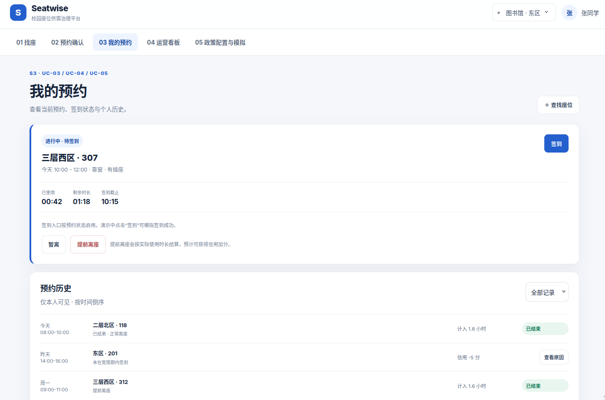

### 8.4 S4 运营看板（UC-11）
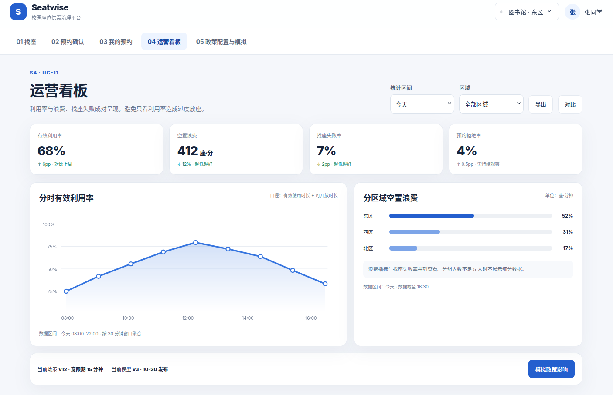

### 8.5 S5 政策配置与模拟（UC-12、UC-14）
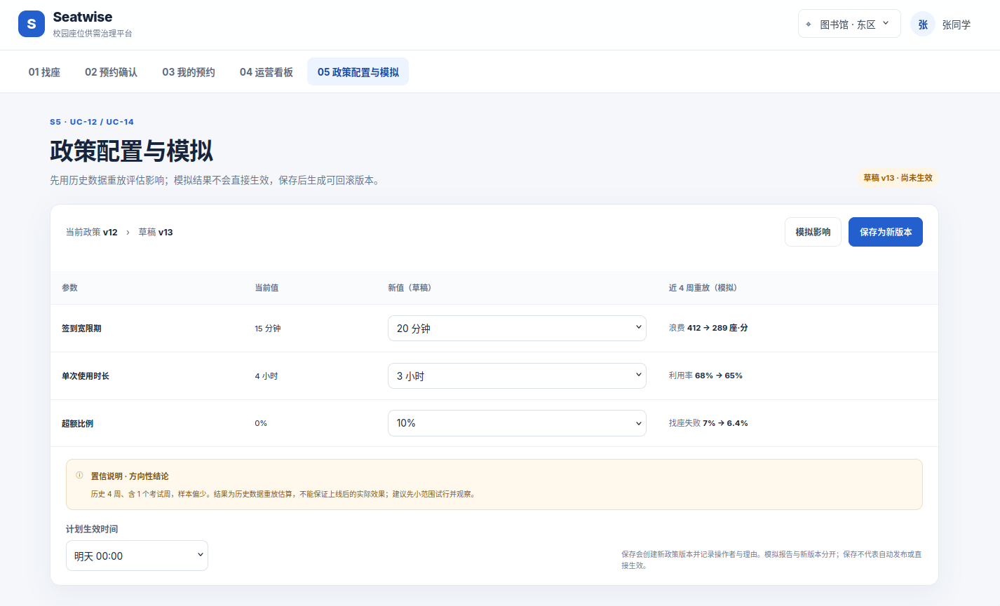

---

## 9. 参考文献

每条均在正文以 [编号] 标注引用位置；注释 30～60 字。

1. 周剑峰, 王伟杰, 杨卫明. 2016—2022 学年广东外语外贸大学图书馆用户行为记录数据集[J]. 图书馆杂志, 2024, 43(401): 106–112. <https://www.libraryjournal.com.cn/CN/abstract/abstract2846.shtml>
   注释：原计划的数据源（含进馆记录、学习空间使用与借阅，4 个文件约 1420 万条）。实测在平台被标记受限、无法下载，已降级为持续申请（见 R7 与附录 A）。

2. Hyndman, R. J., Athanasopoulos, G. *Forecasting: Principles and Practice*. 3rd ed. OTexts, 2021.
   注释：时序预测标准教材，给出基线、回测切分与误差度量规范，是 7.6.1 指标与基线对照的依据。

3. Talluri, K. T., van Ryzin, G. J. *The Theory and Practice of Revenue Management*. Springer, 2004.
   注释：收益管理经典，讨论超额预订的容量控制与风险权衡，本系统有上限的超额准入参考该书。

4. Kleppmann, M. *Designing Data-Intensive Applications*. O'Reilly, 2017.
   注释：讲事务、并发控制与幂等语义；5.4 与 7.3 中“条件更新 + 幂等键”的可靠性设计均以本书为依据。

5. Cunningham, S. *Causal Inference: The Mixtape*. Yale University Press, 2021.
   注释：系统讲解双重差分与合成控制，5.3 与 7.6.1 中“用对照区域做政策归因”的方法与前提检验据此。

6. Sculley, D., Holt, G., Golovin, D., et al. “Hidden Technical Debt in Machine Learning Systems.” *Advances in Neural Information Processing Systems 28 (NIPS 2015)*: 2503–2511.
   注释：指出机器学习系统的隐性维护成本来自数据依赖与配置耦合，支持本文“统计模型只做两类能力、可回退”的取舍。

7. Cox, D. R. “Regression Models and Life-Tables.” *Journal of the Royal Statistical Society: Series B (Methodological)*, 34(2), 1972: 187–220.
   注释：生存分析奠基论文，B1 停留时长模型用其建模“已坐一段时间的人还会坐多久”。
8. Hong Kong University of Science and Technology Library. “Wi-Fi Connection in HKUST Library.” DataSpace@HKUST, 2015（V9.1，2024-06-13）. DOI: 10.14711/dataset/RQXRQB. 许可：CC0 1.0.
   注释：需求侧主数据（v3 起）：2014-02 到 2022-05、98 个月、2,981 天的楼层 × 用户群 × 时段使用统计，用于需求模型、季节性、校历因素与漂移检验。
9. davnas. “real-time-library-occupancy” [KTH 图书馆区域占用数据]. Hugging Face Datasets, 2025.
   注释：占用侧验证集（v3 起）：2024-12 到 2025-07、231 天、6 区域、约 190 秒粒度，用于 30 分钟前瞻基线对照与概率校准。仓库未声明许可证，仅课程内使用。

---

## 10. 团队成员贡献

| 成员 | 负责范围 |
|---|---|
| 兰昊轩 | 后端核心：预约引擎、签到与释放、并发一致性 |
| 郑执 | 数据与模型：数据管道、预测模型与回测、政策模拟、监控 |
| 李博瑞 | 前端与运维：界面、部署、压测与可观测性 |

---

## 11. AI 工具反思

| 维度 | 内容 |
|---|---|
| 工具链 | DeepSeek Harness 编码代理（deepseek-flash） & Pi agent（Mimo-v2.6-pro）：检索数据集、生成结构、检查章节覆盖与术语一致性、校对 UML ；对话式模型：竞品与 SWOT 头脑风暴 |
| 代价 | 93.6M token = deepseek-flash 87.6M + Mimo-v2.6-pro 6M、人工评审+改写约 4 小时 |
| 优点 | 结构完整不漏项；跨章节一致性检查快；能一次给出多个定位并列出反驳理由；文献与数据集检索效率高。 |
| 缺点 | 倾向多写功能、少写证据；不了解课程与团队约束，曾把对话与 LLM 抽取写成核心能力；引用信息不可直接信任。 |
| 验证 | 逐条对照作业清单；NFR 数值由团队确认可达性并绑定验证手段（7.7）；引用逐条核对；新增能力必须先在 3.6 的表中登记并说明写入边界。 |
| 增强 | 本轮以收窄为主：用“输入侧表单 / 输出侧模板”砍掉对话、政策抽取、申诉草拟与运营问答，只保留一个可选的“一句话 → 检索参数”适配层（L1）；AI 收敛为 3 模型 + 3 派生量 + 3 决策器，外加 2 个可选件（L1、A1）的清单；“跑不赢基线就不上线”写成硬约束。 |

反思：AI 降低了从零搭起结构的成本，判断值不值得做仍然要靠人。本项目被质疑的正是后者，本轮最有价值的工作也花在这里。

---

## 12. 变更日志（设计轮修订）

本文档的定位与两条边界（3.6）未变。下表是设计阶段暴露的问题导致的修订，每条都能回溯到具体设计决策。分两批：12.1 是设计首轮的内部修订（R1–R6），12.2 是作业 2 课堂反馈与实测数据导致的修订（R7–R12）。

### 12.1 设计首轮修订（R1–R6）

| ID | 原条款 | 新条款 | 起因（设计暴露的问题） | 影响面 |
|---|---|---|---|---|
| R1 | 5.4 UC-06：幂等键 = 预约号 + 原因；术语 7 “三种来源” | 5.7 新增结算原因枚举（六类 reason code）；5.4 UC-06 幂等键改为 `(预约号, reason, 政策版本)`；术语 7 改为五种来源 | 状态机的“已结束”掩盖了主动离座 / 暂离超时 / 强制释放 / 到期四种成因，而账本与幂等键都依赖可枚举的原因；自由文本无法做去重与统计 | 5.4、 5.7、术语表、7.3.1；图 5-6 不需要改（图的粒度是状态） |
| R2 | 7.1.4：概率必带“区域 + 时段 + 数据时间 + 置信分档”（仅文案约束） | 同条补充落库字段：`zone` / `slot` / `feature_as_of` / `model_version` / `band` / `coverage`，缺任一项即视为口径不完整 | 工件版本化 + 在线打分后，同一个概率在不同模型版本下不可比；“数据时间”不落到字段就无法回放与归因 | 7.1.4、3.6 的 D2 行、UI 概率组件、结果表 schema |
| R3 | 7.3.1：叫“释放、扣分、签到幂等”，键的粒度未定义 | 7.3.1 改为四类写操作（预约、签到、释放、扣分）全部幂等，幂等键 = `(业务键, op, version)` 加唯一索引 | 原条款只给释放定义了键，而签到与扣分同样在客户端重试与定时任务重放的路径上；没有统一幂等表，四类写接口各写一套去重逻辑 | 7.3.1、5.4、幂等表 schema、四类写接口 |
| R4 | 7.4.4：3 年约 100 万条预约，报表 ≤ 2 秒 | 7.4.4：报表读分钟级物化汇总表，≤ 2 秒；汇总口径与 BG1–BG5 一致，口径变更须同步汇总任务 | 百万级明细 + 实时聚合与 2 秒指标冲突；且 BG1–BG5 的分子分母若不写成口径表，汇总任务与报表会各算一套 | 7.4.4、5.4 UC-11、BG1–BG5 的算法定义 |
| R5 | 术语 8：信用分“由计分规则累积得到”；7.2 无写权限条款 | 术语 8 注明由账本派生；新增 7.2.6：任何接口不得直接写信用分，更正只能追加冲正记录 | 信用分若是可写字段，扣分与申诉撤销就会出现两条真相；账本只追加才能支撑“每个决定可解释”（7.1.3） | 术语表、7.2.6、UC-07 / UC-13 |
| R6 | 7.3.2 / 7.4.3：500 并发、≥ 200 req/s（无推导） | 7.3.2 与 7.4.3 改为 100 并发、≥ 20 req/s，并在 7.4 补推导：日均约 913 次、高峰均值约 0.4 req/s，验收值含数十倍余量 | 教师反馈指出性能与容量指标对课程项目过高；原数值无推导，也无法在演示环境演示 | 7.3.2、7.4.3、7.4.4、7.7、M1 退出准则；附录 A 补聚合规模与模型路线 |

### 12.2 作业 2 设计轮修订（R7–R12）

| ID | 原条款 | 新条款 | 起因（设计暴露的问题 / 反馈） | 影响面 |
|---|---|---|---|---|
| R7 | 附录 A：以广外数据集（1420 万条）为有效数据 | 有效数据改为 HKUST 图书馆 WiFi 使用统计（需求侧，CC0）+ KTH 图书馆区域占用（占用侧验证集）；广外与江苏大学两份降级为“持续申请中” | 两份《图书馆杂志》数据集在平台被标记**受限**，接口亦全部 412；设计不能绑在不可得的数据上 | 附录 A、3.5、7.6.1、M3 退出准则 |
| R8 | 7.6.1：30 分钟前瞻 MAE ≤ 8pp 且相对持续性基线提升 ≥ 25%；BG1 目标 +8% | 拆为日粒度需求预测（相对 persistence ≥ 20%，实测 22.0%）与 30 分钟前瞻（不劣于 persistence 10% + 校准 ≤ 5pp）；BG1 目标改为 +5%（中性档，区间 +1.8%～+11.0%） | 实测 persistence 在 30 分钟尺度 MAE 仅 0.030，原目标不可达也无意义；利用率提升需由 `w·r/(1−w)` 推导，原 +8% 落在乐观档 | 7.6.1、3.5 BG1、7.7、M3/M4 退出准则 |
| R9 | 5.3 无候补用例；UC-12 参数 4 项 | 新增 UC-18 候补队列与自动补位；UC-12 参数扩为 8 项（增加候补容量、确认超时、信用优先档位、峰值轮换间隔） | 教师反馈 1：除历史数据与经验规则外还有其它优化资源利用的方式；候补与优先权不需要新数据 | 5.3、5.4、UC-12、设计文档 4.3 / 7.1 |
| R10 | 无数据质量条款；外部因素未出现 | 新增 7.4.6 六维质量闸门与 7.6.5 外部因素接入 | 教师反馈 3：数据质量与历史数据增强需要考虑；实测校历把解释力从 0.177 提到 0.434，并发现“楼层求和 ≠ 去重总量”的语义陷阱 | 7.4.6、7.6.5、附录 A |
| R11 | 7.3 无漂移条款 | 新增 7.3.6 漂移检测与再训练触发、7.5.6 结构变更留痕 | 教师反馈 2：如何提高适应能力；实测 2020 年需求降至常态 1/5，楼层份额最大位移 16 个百分点 | 7.3.6、7.5.6、M5 演练 |
| R12 | 7.1.4 四项口径；7.6.4 未提代理指标 | 7.1.4 增加 `coverage` 与代理口径声明：WiFi / 门禁推断的人数必须标注“代理口径”，不得与座位占用混称 | 实测 WiFi 连接数 / 人数 = 7.79，人数为设备去重估算，直接当座位数会系统性高估 | 7.1.4、7.6.4、8.1、UC-01/09 |

未变的部分（本次未动的条款）：产品定位与取舍（2.1、4.1）、统计模型与 LLM 的能力清单及两条边界（3.6）、里程碑的时间节点（4.2，退出准则按 R8/R10 调整）、参与者与用例划分（5.1～5.2）、非目标清单。

术语说明：本轮统一了称谓，系统侧能力一律称“统计模型”或“LLM”，两者分别决策（3.6、7.3.4、7.6、7.7 已同步）；11 节“AI 工具反思”保留原称，指的是编写本文档所用的工具，与系统能力无关。

设计轮的配套产物：逻辑/部署/技术视图与 ADR-1～9、领域类图、用例实现时序图、UI 组件规格、优化目标推导、治理杠杆与扩展点、开放问题与验证矩阵，见 [DESIGN.md](DESIGN.md) 第 2、3、4、6、7、8、9 章。

---

## 附录 A. 数据来源

数据前提（v3 修订，见 R7）：原计划的广外数据集与江苏大学数据集在《图书馆杂志》数据平台均被标记为受限，登录后仍不可下载，接口探测返回 412，因此不再作为论证前提，降级为持续申请中。当前有效数据改为两份可复核的公开数据，分工如下：

| 数据 | 内容与粒度 | 许可 | 用途 |
|---|---|---|---|
| **HKUST 图书馆 WiFi 使用统计**（需求侧主数据） | 2014-02 → 2022-05，98 个月，日 × 楼层 × 用户群 + 日 × 时段 × 用户群（小时级仅 2020-06）；143,088 + 158,424 + 34,560 行 | CC0 1.0，DOI `10.14711/dataset/RQXRQB` | B3 需求模型、层级失衡、季节性、校历因素、漂移检验、数据质量评估 |
| **KTH 图书馆区域占用**（占用侧验证集） | 2024-12 → 2025-07，231 天，6 区域，约 190 秒粒度，95,164 行 | 未声明许可证，仅课程内方法验证、不随代码分发 | D1/D2 短时预测、基线对照、概率校准、引导价值估算 |
| 自建系统日志（Part III） | 预约、签到、释放事件 | 系统自有 | 标定爽约率、停留时长分布、可迁移比例 θ |
| 广外 2016—2022、江苏大学 2020 学年（受限） | 1,420 万条 / 5 个文件，后含座位预约记录（预约、签到、签退、使用时长） | 平台受限 | 解禁后优先替换前两项；江苏大学那份字段更对口 |

训练规模：HKUST 数据按“（楼层/区域）× 时段 × 日”聚合后约 18 万行；KTH 数据重采样到 30 分钟后约 2.9 万行（231 天 × 210 个采样点 × 6 区域）。三个模型都用经典方法（生存分析、二分类、分位数回归），单机 CPU 完成训练，不训练深度序列模型，也不对 LLM 做微调。

口径限制（必须随结果一并声明）：

1. WiFi 人数是设备去重估算（`WiFi-Conn / User-Count = 7.79`），不等于座位占用人数，只能做需求侧口径（7.1.4 代理口径声明）。
2. “All-Floors” 为跨楼层去重值，楼层值为分别计数。总量用前者，层级用后者，两者不得相加（只有 3.15% 的日期相等）。
3. 闭馆期（零人次 62 天）、封顶伪影（值恰为 100）、暑期闭馆段与 2020 年制度断点按 7.4.6 剔除或单列为漂移检验集。
4. 两份数据均非本校数据，改善目标的外推需 Part III 以自有日志复核一次。

实时占用由预约、签到、释放推断，区域 × 座位维度不足时用模拟器补齐；图表须标注数据区间与剔除规则（见 7.6.1）。全部实测数字由同一套脚本从上述两份原始数据算出，可按本节的分工复算复核。
